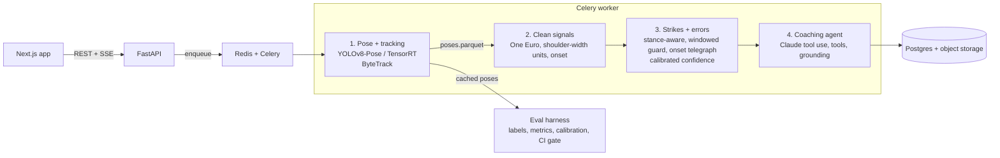
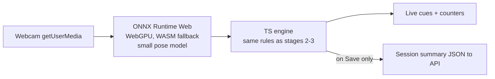

# CornerMan AI v2.0: Functional Requirements Document (FRD v3.0)

| Field | Value |
|---|---|
| Project | CornerMan AI (github.com/timsletap/CornerMan-AI) |
| Owner | Smit Patel |
| Document version | 3.0 (supersedes `FRD.md` v2.0, Feb 6 2026) |
| Date | 2026-10-19 |
| Audience | Coding agents first, human reviewers second |
| Status | Approved for implementation, milestone by milestone |

---

## Table of contents

0. Instructions for the coding agent
1. Context and motivation
2. Goals, principles, success metrics
3. v1 audit (what exists, what is wrong, what fixes it)
4. Current repo map (v1)
5. Target architecture and repo layout (v2)
6. Cross-cutting specifications (config, database, API, data formats)
7. Tasks by milestone (M0 to M6) with acceptance criteria
8. Stretch backlog and v3 ideas
9. Risks and mitigations
10. Open questions for the owner
11. Glossary
12. Appendix A: Definition of done checklist
13. Appendix B: Owner notes (showcase and resume, not for the agent)

---

## 0. Instructions for the coding agent

**Workflow**
- Work **one task ID at a time**, in the order given in Section 7. One branch and one PR per task ID, named `<type>/<TASK-ID>-<slug>` (for example `feat/VIS-12-stance-aware`, `chore/PLT-06-repo-hygiene`).
- A task is done only when every checkbox under its **Acceptance** passes, `make check` is green, and the PR description follows the template below.
- Milestones are sequential. Do not start a milestone until the previous milestone's **Gate** is met. Tasks within a milestone run in the listed order unless marked "parallel-safe".

**PR description template**
```
## Task
<TASK-ID>: <title>

## What changed
- ...

## Eval delta (required for any change under backend/app/vision/, backend/app/coaching/, or eval/ from M1 onward)
| Metric (dev split) | Before | After |
|---|---|---|

## New dependencies (name, version, one-line reason)

## Config / migration changes

## Open questions (TODO(question) items left in code)
```

**Hard rules**
- From M1 onward, any change to vision or coaching logic must include the eval delta. If dev-split strike F1 drops more than 2.0 points, revert the change instead of merging.
- Never tune thresholds or fit calibration on the **test** split. Test is for final reporting only.
- Do not change existing public API routes or response shapes unless the task says so. Additive fields are fine. The frontend depends on current shapes.
- Do not add dependencies without listing them in the PR with a reason.
- Never commit secrets, `.env` files, model weights (`*.pt`, `*.onnx`, `*.engine`), labeled clips, pilot participant data, or anything with a real person's identity.
- If a requirement is ambiguous, leave `TODO(question): <question>` in code, note it in the PR, and do not guess. Section 10 lists questions only the owner can answer.
- Every number that ends up in the README or docs must be generated by a committed script from a committed report. Never hand-type metrics.

**Style**
- Python 3.11, type hints everywhere, `ruff` for lint and format, `mypy --strict` on all new packages (`backend/app/vision/`, `backend/app/coaching/`, `eval/`, `perf/`).
- Pydantic v2 models for all structured data crossing a boundary (API, Celery, LLM, files on disk).
- Pure functions for stages 2 and 3 of the vision pipeline: no I/O, no DB, no progress calls, no global state.
- TypeScript strict mode on the frontend; Vitest for unit tests.
- Docstrings on public functions state units for every numeric argument (pixels, shoulder-widths, ms, frames).

---

## 1. Context and motivation

### 1.1 What CornerMan does today (v1)
CornerMan AI analyzes combat sports striking footage (MMA, boxing, Muay Thai):
1. **Pose:** YOLOv8-Pose extracts 17 COCO keypoints per frame and picks a "primary actor".
2. **Strikes:** wrist velocity peaks above a threshold become strikes, debounced at 0.3 s, then classified as `jab`, `cross`, `hook`, `uppercut`, or `body_shot` with geometric heuristics.
3. **Errors:** `dropped_guard` (off-hand wrist to nose distance at the strike frame) and `chicken_wing` (elbow x variance in the 10 frames before the strike).
4. **Overlay:** an annotated video with skeleton, strike labels, velocity vectors, guard lines, and a HUD.
5. **Coaching:** Claude receives the vision JSON and the fighter profile and returns corner-coach feedback; errors map deterministically to drills.

Stack: Next.js 16, React 19, Tailwind 4, TypeScript; FastAPI, SQLAlchemy 2, Alembic, Pydantic v2; Celery + Redis; PostgreSQL 16; Ultralytics, OpenCV, NumPy; Anthropic SDK; FFmpeg, yt-dlp; Docker Compose.

### 1.2 Why v2
v1 answers "what did the model see?" but not "was it right?" Every threshold is hand-tuned and nothing in the repo measures accuracy. A coach who gives confident wrong feedback is worse than no coach. v2 is built around **ground truth first, features second**: build a labeled evaluation set, measure v1, then fix and extend the system with every change scored against that set.

### 1.3 Why this owner
The owner fought for his MMA team and coached youth MMA and wrestling. That domain knowledge drives the requirements: a jab is defined by the lead hand, not by arm extension; telegraphing happens before the punch starts, not at its peak; a guard drops during the punch, not just at one frame. The owner labels the footage, reviews flags, and runs the real-user pilot.

---

## 2. Goals, principles, success metrics

### 2.1 Goals
1. **Measured accuracy:** every claim the app makes is backed by a reproducible number on held-out labeled footage.
2. **Correct vision:** fix the known signal-processing and domain errors in v1.
3. **Trustworthy coaching:** the LLM only says what the data supports, and the system knows when it is unsure.
4. **Production hygiene:** safe to expose publicly, tested, CI-gated.
5. **Depth:** calibrated confidence, data-efficient labeling, optimized and on-device inference, a tool-using longitudinal agent, and validation with real fighters.
6. **Visible:** a stranger understands the project within 10 seconds of opening the repo.

### 2.2 Principles
- Ground truth before features.
- Explainable heuristics first; learned models must beat them on the same split to replace them.
- The system says "unsure" rather than guessing.
- Every result is reproducible from a command and a git SHA.
- Privacy by default: no faces in public media, no video leaves the device in shadowbox mode, delete means delete.

### 2.3 Success metrics
Targets marked "after M1" are set once the v1 baseline exists. Do not invent targets earlier.

| Goal | Metric | Definition | Source task | Target |
|---|---|---|---|---|
| Find strikes | Strike detection precision, recall, F1 | Same hand, within ±150 ms, one-to-one matching | EVAL-04 | after M1 |
| Name strikes | Strike-type macro-F1, confusion matrix | On matched pairs only | EVAL-04 | after M1 |
| Real errors | Precision and recall per error type | Same matching rule as strikes | EVAL-04 | after M1 |
| One fighter | Identity switches per clip | Target track changes to another person | EVAL-04 | 0 on eval set |
| Speed (server) | Throughput | Video seconds per wall-clock second, stage 1 and stages 2 to 3 separately | EVAL-04, PERF-01 | after M1 |
| Speed (browser) | fps, end-to-end latency | Frame capture to cue rendered | RT-01 | >= 24 fps, median < 150 ms |
| Honest confidence | Expected calibration error (ECE) | 10-bin ECE on test split | CAL-01 | lower than uncalibrated |
| Label efficiency | Labels to reach target macro-F1 | Uncertainty vs. random sampling | DATA-01 | fewer with uncertainty sampling |
| Grounded coaching | Ungrounded claims | Claims not traceable to vision data or tool results | AGT-07, AGT-12 | 0 |
| Agent quality | Planted-pattern detection rate, rubric score | 10 synthetic histories | AGT-12 | after first run |
| Real-world value | Flag agreement rate, weekly retention | Pilot users | USR-01 | after pilot |
| Reliability | Line coverage of `backend/app/vision/` | pytest-cov | QA-05 | >= 80% |

---

## 3. v1 audit

### 3.1 What v1 gets right (preserve these)
- Async pipeline: Celery workers with progress reporting via `services/progress.py`.
- Ownership checks: every query in `api/v1/videos.py` and `api/v1/analysis.py` filters by `user_id == current_user.id`.
- Deterministic coaching fallback when `ANTHROPIC_API_KEY` is empty.
- Deterministic error-to-drill mapping (`services/drill_mapping.py`, `services/seed_drills.py`).
- Alembic migrations and Docker Compose for the full stack.
- A written FRD (v2.0) with requirement IDs.

### 3.2 Findings

| # | Area | Finding | Location | Why it matters | Fixed by |
|---|---|---|---|---|---|
| 1 | Evaluation | No labeled data, no accuracy numbers, all thresholds hand-tuned | `config.py` | Can't tell if a change helps or hurts | EVAL-01 to 06 |
| 2 | Classification | Jab vs. cross decided by arm extension ratio (`arm_ext / torso_height > 0.8`); profile stance is stored but never used by vision | `VisionPipeline._classify_strike` | A jab is the lead hand by definition | VIS-12 |
| 3 | Velocity | Raw frame-to-frame wrist deltas, no smoothing | `VisionPipeline.detect_strikes` | Keypoint jitter creates false strikes | VIS-10 |
| 4 | Normalization | Velocity divided by frame height | `VisionPipeline.detect_strikes` | A fighter far from the camera looks slower | VIS-11 |
| 5 | Telegraph | `std(elbow_x) / mean(elbow_x)` in raw pixels, window ends at the velocity peak | `VisionPipeline.detect_telegraph` | Same flare scores about 10x higher at x=100 than x=1000; the punch itself counts as telegraphing | VIS-13 |
| 6 | Guard | Measured at one frame only | `VisionPipeline.analyze_guard` | Guard often drops mid-extension | VIS-14 |
| 7 | Tracking | Primary actor re-selected independently every frame (`0.6 * area + 0.4 * centrality`) | `VisionPipeline._select_primary_actor` | Can jump between sparring partners mid-clip | VIS-09 |
| 8 | Structure | 914-line class mixing inference, signal processing, rules, rendering, and progress I/O | `services/vision.py` | Untestable; slow iteration (full inference to retune a threshold) | VIS-08 |
| 9 | LLM output | `json.loads` on free text, no schema, no retry; cited timestamps unchecked | `services/coaching.py` | Fragile parsing; hallucinated feedback possible | AGT-05 to 08 |
| 10 | LLM config | Model ID default and per-token prices hardcoded (`0.003`, `0.015` per 1k) | `config.py`, `coaching.py` | Wrong costs when model changes | AGT-09 |
| 11 | Uploads | `await file.read()` loads the whole file; limit is 2000 MB | `api/v1/videos.py::upload_video` | Memory exhaustion | PLT-01 |
| 12 | Validation | File type checked by extension only | `upload_video` | Non-video files reach the pipeline | PLT-02 |
| 13 | Auth | JWT accepted in `?token=` query string for streams | `api/deps.py::get_current_user_from_token_or_query` | Tokens leak into logs, history, referrers | PLT-03 |
| 14 | Config | `SECRET_KEY` defaults to `change-me-to-a-random-secret-key`; `DEBUG=True` default | `config.py` | Insecure if deployed as-is | PLT-04 |
| 15 | Limits | `FREE_TIER_DAILY_UPLOADS=999`, `API_CREDIT_HOURLY_LIMIT=999.00` | `config.py`, `.env.example` | Unbounded API spend on a public demo | PLT-05 |
| 16 | Progress | Frontend polls with `setInterval` | `frontend/src/app/(protected)/sessions/[sessionId]/page.tsx` | Wasteful; laggy UI | PLT-07 |
| 17 | Repo | 53 MB `backend/yolov8m-pose.pt` and `.claude/settings.local.json` committed | repo root | Slow clones; looks unmaintained | PLT-06 |
| 18 | Testing | No tests, no CI | whole repo | Regressions go unnoticed | QA-01 to 06 |
| 19 | Docs | README clone URL says `YOUR_USERNAME`; no screenshots or GIF; no accuracy section | `README.md` | Reviewers can't see it work | SHW-01 to 04 |
| 20 | Confidence | Outputs have no calibrated confidence; system never abstains | vision + coaching | Confidently wrong feedback | CAL-01, VIS-15 |
| 21 | Privacy | Faces visible in annotated exports; delete may leave derived files | `render`, delete endpoints | Privacy risk for sparring partners | USR-02, PLT-10 |

---

## 4. Current repo map (v1)

```
backend/app/
  main.py                    FastAPI entry
  config.py                  Pydantic Settings (all thresholds and limits)
  database.py                engine + session
  api/deps.py                get_db, get_current_user, get_current_user_from_token_or_query
  api/v1/router.py
  api/v1/users.py            register, login, me
  api/v1/videos.py           upload, list, get, trim, stream, delete
  api/v1/analysis.py         trigger, sessions, progress, annotated stream, delete, feedback, dispute
  api/v1/drills.py
  api/v1/youtube.py          search, download
  core/security.py           bcrypt, JWT (python-jose)
  core/exceptions.py
  models/                    user, video, analysis, strike, error_flag, drill, feedback, usage
  schemas/                   user, video, analysis, common
  services/vision.py         VisionPipeline (914 lines)
  services/coaching.py       Claude call + fallback
  services/video.py          save, validate, delete
  services/youtube.py        yt-dlp download + h264 transcode
  services/usage.py          quotas
  services/progress.py       progress store
  services/drill_mapping.py, seed_drills.py
  tasks/celery_app.py, analysis_tasks.py, video_tasks.py
backend/alembic/versions/    initial schema, annotated_video_path
backend/yolov8m-pose.pt      53 MB, committed (remove)
frontend/src/app/            App Router pages: login, register, dashboard, upload, search, videos/[videoId], sessions/[sessionId], profile
frontend/src/components/     ui, auth, coaching, layout, video, analysis
frontend/src/lib/api.ts, types.ts
frontend/src/context/auth-context.tsx
docker-compose.yml           db, redis, app, celery-worker, frontend
FRD.md                       v2.0 (VIS-01..07, AGT-01..04, VID-*, LIM-*)
```

---

## 5. Target architecture and repo layout (v2)

### 5.1 Pipeline (server)



Stage 1 is the only slow step. Caching its output (`poses.parquet`) lets the eval harness rerun stages 2 and 3 in seconds, so every change gets a score.

### 5.2 Shadowbox mode (browser, on-device)



No frames leave the device. The TypeScript engine is kept identical to Python by a shared fixture parity suite.

### 5.3 Target repo layout

```
backend/app/
  vision/
    __init__.py
    types.py            FrameKeypoints, Track, Strike, ErrorFlag (Pydantic), units documented
    pose.py             Stage 1: inference backends (pytorch, onnx, tensorrt), tracking, writes poses cache
    tracking.py         target selection, re-acquisition
    signals.py          Stage 2: One Euro filter, body-relative scale, velocity, motion onset
    strikes.py          Stage 3a: detection, stance mapping, classification
    errors.py           Stage 3b: guard window, telegraph
    confidence.py       confidence features, calibration application, abstention
    faces.py            face detection + blur (USR-02)
    render.py           overlay video rendering
    pipeline.py         orchestration, progress, persistence
  coaching/
    schema.py           CoachingReport and related models
    agent.py            tool-use loop, retry, fallback
    tools.py            read-only, user-scoped tools (AGT-12)
    grounding.py        claim validation against vision output and tool results
    prompts/v1.md       versioned system prompt
  api/v1/media.py       signed URLs (PLT-03)
  api/v1/events.py      SSE progress (PLT-07)
  api/v1/demo.py        public demo sessions (SHW-02)
  api/v1/shadowbox.py   save shadowbox summaries (RT-01)
eval/
  schema.py             label + report models, validators
  match.py              prediction-label matching
  run.py                python -m eval.run --split dev|test [--calibration] [--with-coaching]
  calibration.py        reliability diagram, ECE, fitting
  active.py             rank + export pre-labels (DATA-01)
  readme_table.py       prints README accuracy table from a report
  splits.yaml
  labels/               *.json (gitignored), samples/ committed
  clips/                gitignored
  reports/              committed JSON/CSV/PNG outputs
  LABELING.md
perf/
  export.py             ONNX + TensorRT export, INT8 calibration
  bench.py              latency/throughput/accuracy table
frontend/src/
  app/(protected)/shadowbox/page.tsx
  app/demo/             public demo pages
  features/shadowbox/engine/   TS port of stages 2-3
  features/shadowbox/model/    ORT Web loading
tests/
  unit/vision/, unit/coaching/, unit/eval/
  api/
  golden/               5 s clip + expected output
  fixtures/parity/      Python-generated fixtures for TS parity tests
docs/
  demo.gif, before_after.gif
  DESIGN.md, PERFORMANCE.md, PRIVACY.md, PILOT.md
.github/workflows/ci.yml
Makefile
FRD-v3.md               this document
```

`services/vision.py` and `services/coaching.py` become thin shims calling the new packages during migration, then are deleted once nothing imports them.

---

## 6. Cross-cutting specifications

### 6.1 Units and conventions
- Time: `t_ms` integer milliseconds from video start. Frames: `frame_number` integer, 0-based, in source fps.
- Image coordinates: pixels, origin top-left, y increases downward (so upward motion has negative dy).
- Body-relative units (from VIS-11 on): `sw` = shoulder-widths; velocities in `sw/s`.
- Hands: `left`/`right` refer to the fighter's anatomical hands. `hand_role` is `lead`/`rear`.
- Stance: `orthodox` (left lead) or `southpaw` (right lead).
- COCO keypoint indices: 0 nose, 5/6 shoulders, 7/8 elbows, 9/10 wrists, 11/12 hips, 13/14 knees, 15/16 ankles (left/right).

### 6.2 Configuration changes (`backend/app/config.py`)

| Key | Change | Default | Used by |
|---|---|---|---|
| `SECRET_KEY` | Validated in production (>= 32 bytes, not default) | unchanged | PLT-04 |
| `DEBUG` | Must be false in production | `True` in dev | PLT-04 |
| `ANTHROPIC_MODEL` | Update default to a current model; stays configurable | current model ID | AGT-09 |
| `ANTHROPIC_PRICE_INPUT_PER_MTOK` | New | set to model's price | AGT-09 |
| `ANTHROPIC_PRICE_OUTPUT_PER_MTOK` | New | set to model's price | AGT-09 |
| `PROMPT_VERSION` | New | `v1` | AGT-11 |
| `AGENT_MAX_TOOL_CALLS` | New | `6` | AGT-12 |
| `STRIKE_VELOCITY_THRESHOLD` | Units change to `sw/s`; re-tuned on dev | tuned | VIS-11 |
| `GUARD_DISTANCE_THRESHOLD` | Units change to `sw`; re-tuned on dev | tuned | VIS-11, VIS-14 |
| `TELEGRAPH_VARIANCE_THRESHOLD` | **Removed** | n/a | VIS-13 |
| `TELEGRAPH_OFFSET_THRESHOLD` | New, in `sw` | tuned | VIS-13 |
| `TELEGRAPH_WINDOW_FRAMES` | New | `10` | VIS-13 |
| `ONSET_FRACTION` | New | `0.2` | VIS-13, VIS-14 |
| `ONE_EURO_MIN_CUTOFF`, `ONE_EURO_BETA`, `ONE_EURO_D_CUTOFF` | New | tuned | VIS-10 |
| `TRACKER_CONFIG` | New | `bytetrack.yaml` | VIS-09 |
| `TARGET_SELECT_SECONDS` | New | `2.0` | VIS-09 |
| `REACQUIRE_IOU`, `REACQUIRE_SECONDS` | New | `0.3`, `1.0` | VIS-09 |
| `ABSTAIN_THRESHOLD` | New | chosen on dev | CAL-01 |
| `INFERENCE_BACKEND` | New: `pytorch`, `onnx`, `tensorrt_fp16`, `tensorrt_int8` | `pytorch` until PERF-01 | PERF-01 |
| `INFERENCE_BATCH_SIZE` | New | `8` | PERF-01 |
| `MEDIA_URL_TTL_SECONDS` | New | `300` | PLT-03 |
| `FACE_BLUR_ENABLED` | New | `true` | USR-02 |
| `MAX_VIDEO_SIZE_MB` | Lowered | `500` | PLT-01 |
| `FREE_TIER_DAILY_UPLOADS` | Lowered | `5` | PLT-05 |
| `API_CREDIT_HOURLY_LIMIT` | Lowered, USD | `1.00` | PLT-05 |
| `CLAUDE_COST_PER_CALL` | **Removed** (cost computed from usage) | n/a | AGT-09 |

Update `backend/.env.example` and the README configuration table to match.

### 6.3 Database changes (Alembic, one migration per task that needs it)

| Table | Column | Type | Task |
|---|---|---|---|
| `strikes` | `hand_role` | enum `lead`/`rear` | VIS-12 |
| `strikes` | `confidence` | float | CAL-01 |
| `strikes` | `abstained` | bool | CAL-01 |
| `strikes` | `onset_ms` | int | VIS-13 |
| `error_flags` | `confidence` | float | CAL-01 |
| `error_flags` | `window_start_ms`, `window_end_ms` | int | VIS-13, VIS-14 |
| `error_flags` | `measured_value_sw` | float | VIS-11 |
| `analysis_sessions` | `stance_used`, `stance_source` (`profile`/`detected`) | enum | VIS-12 |
| `analysis_sessions` | `target_track_id` | int | VIS-09 |
| `analysis_sessions` | `poses_cache_path` | text | VIS-08 |
| `analysis_sessions` | `stage_timings` | JSONB | PLT-09 |
| `analysis_sessions` | `inference_backend` | text | PERF-01 |
| `analysis_sessions` | `prompt_version`, `llm_model` | text | AGT-11 |
| `analysis_sessions` | `coaching_report` | JSONB (CoachingReport incl. `trends`, `tool_calls`) | AGT-05, AGT-12 |
| `item_feedback` (new) | `id`, `user_id`, `session_id`, `item_type` (`strike`/`error`/`note`), `item_id`, `agree` bool, `comment`, `created_at` | | USR-01 |
| `shadowbox_sessions` (new) | `id`, `user_id`, `started_at`, `duration_s`, `summary` JSONB | | RT-01 |
| `users` | `pilot_participant` bool | | USR-01 |

All foreign keys from derived tables to `videos` / `analysis_sessions` use `ON DELETE CASCADE` (PLT-10).

### 6.4 API changes

| Method | Route | Change | Task |
|---|---|---|---|
| POST | `/api/v1/videos/upload` | Streaming write, ffprobe validation, 413 on oversize | PLT-01, PLT-02 |
| POST | `/api/v1/videos/{id}/analyze` | Optional body `{target_track_id?, stance_override?}` | VIS-09, VIS-12 |
| POST | `/api/v1/media/sign` | **New.** Body `{resource_type: "video"|"annotated", resource_id}` returns `{url, expires_at}` | PLT-03 |
| GET | `/api/v1/videos/{id}/stream`, `/api/v1/sessions/{id}/annotated-stream` | Accept signed URL params only; `?token=` removed | PLT-03 |
| GET | `/api/v1/sessions/{id}/events` | **New.** SSE progress stream | PLT-07 |
| GET | `/api/v1/sessions/{id}/progress` | Kept for compatibility; frontend stops using it | PLT-07 |
| GET | `/api/v1/demo/sessions`, `/api/v1/demo/sessions/{id}` | **New.** Public, read-only, precomputed | SHW-02 |
| POST | `/api/v1/sessions/{id}/items/{item_id}/feedback` | **New.** `{item_type, agree, comment?}`; supersedes `dispute_error` (keep old route as alias) | USR-01 |
| POST | `/api/v1/shadowbox/sessions` | **New.** Save end-of-session summary | RT-01 |
| GET | `/api/v1/shadowbox/sessions` | **New.** List own summaries | RT-01 |

### 6.5 Label format (`eval/labels/<clip_id>.json`)

```json
{
  "clip_id": "spar_2026_10_22_a",
  "fps": 30,
  "tags": ["sparring", "far", "side"],
  "fighter": {"stance": "orthodox", "track_hint": "left of frame at t=0"},
  "strikes": [
    {"t_ms": 4120, "hand": "left", "type": "jab", "target": "head"},
    {"t_ms": 4480, "hand": "right", "type": "cross", "target": "head"}
  ],
  "errors": [
    {"t_ms": 4480, "type": "dropped_guard", "hand": "left"}
  ],
  "labeler": "owner",
  "label_version": 1
}
```

Enums: `stance in {orthodox, southpaw}`; `hand in {left, right}`; strike `type in {jab, cross, hook, uppercut, body_shot}`; `target in {head, body}`; error `type in {dropped_guard, chicken_wing}`; tags from `{bag, pads, shadow, sparring, near, far, side, three_quarter, head_on, indoor, outdoor}`. `t_ms` = frame of full extension.

`eval/splits.yaml`:
```yaml
dev:  [clip_id, ...]
test: [clip_id, ...]
seed: [clip_id, ...]        # 5 clips used as the DATA-01 starting set (subset of dev)
fighters:                    # clip_id -> anonymous fighter id, used to enforce split by fighter
  spar_2026_10_22_a: F01
```

### 6.6 Eval report format (`eval/reports/<git_sha>_<split>.json`)

```json
{
  "git_sha": "abc1234",
  "split": "dev",
  "created_at": "2026-11-01T12:00:00Z",
  "config_hash": "sha256:...",
  "match_window_ms": 150,
  "detection": {"tp": 0, "fp": 0, "fn": 0, "precision": 0.0, "recall": 0.0, "f1": 0.0},
  "strike_type": {"macro_f1": 0.0, "per_class": {"jab": {"precision": 0.0, "recall": 0.0, "f1": 0.0, "support": 0}}, "confusion": {"labels": ["jab", "cross", "hook", "uppercut", "body_shot"], "matrix": [[0]]}},
  "errors": {"dropped_guard": {"precision": 0.0, "recall": 0.0}, "chicken_wing": {"precision": 0.0, "recall": 0.0}},
  "identity_switches": {"total": 0, "per_clip": {}},
  "throughput": {"stage1_x_realtime": 0.0, "stages23_x_realtime": 0.0, "hardware": "..."},
  "calibration": {"ece_before": null, "ece_after": null},
  "by_tag": {"far": {"detection_f1": 0.0}}
}
```

### 6.7 Coaching report schema (`backend/app/coaching/schema.py`)

```python
class KeyMetric(BaseModel):
    name: str
    value: float
    unit: str
    source_field: str              # dotted path into vision output, e.g. "metrics.guard_score"

class PrescribedDrill(BaseModel):
    error_type: Literal["dropped_guard", "chicken_wing", "other"]
    drill_id: str                  # must exist in the drills table
    reasoning: str

class Note(BaseModel):
    text: str
    t_ms: int | None
    evidence_field: str            # dotted path into vision output or "tool:<call_id>.<path>"

class Trend(BaseModel):            # AGT-12
    metric: str
    direction: Literal["improving", "worsening", "flat"]
    summary: str
    evidence_tool_call_id: str

class ToolCallRecord(BaseModel):   # AGT-12
    id: str
    name: str
    arguments: dict[str, Any]
    result_digest: str             # short hash or truncated result for audit

class CoachingReport(BaseModel):
    summary: str
    key_metric: KeyMetric
    one_thing: str
    prescribed_drill: PrescribedDrill
    notes: list[Note] = Field(max_length=5)
    trends: list[Trend] = []
    tool_calls: list[ToolCallRecord] = []
    removed_claims: list[str] = []  # filled by grounding, for audit
    prompt_version: str
    model: str
    usage: dict[str, int | float]   # input_tokens, output_tokens, cost_usd
```

---

## 7. Tasks by milestone

Milestone overview:

| Milestone | Theme | Tasks | Gate |
|---|---|---|---|
| M0 | Cleanup | PLT-06, PLT-04, QA-05 (part 1) | CI green on `main` |
| M1 | Measure | QA-02, VIS-08, EVAL-01, EVAL-02, EVAL-03, EVAL-04 | v1 baseline report committed |
| M2 | Fix the vision | EVAL-05, VIS-09, VIS-10, VIS-11, VIS-12, VIS-13, VIS-14 | Each change improves or holds dev F1 |
| M3 | Trustworthy coaching | AGT-05, AGT-06, AGT-07, AGT-08, AGT-09, AGT-11, QA-04 | 0 ungrounded claims on dev |
| M4 | Harden | PLT-01, PLT-02, PLT-03, PLT-04 (done), PLT-05, PLT-07, PLT-10, QA-01, QA-03 | Security tests pass |
| M5 | Show it | SHW-01, SHW-03, SHW-04, SHW-02 | Stranger understands repo in 10 s |
| M6 | Go deeper | CAL-01, DATA-01, PERF-01, RT-01, AGT-12, USR-02, USR-01 | Each result table committed and linked from README |

Dependency notes: M1 needs the owner to label at least 10 clips (agent builds tooling, owner labels). PERF-01 needs an NVIDIA GPU (Section 10). USR-01 needs SHW-02 (hosted app) and USR-02 (face blur) done first.

---

### M0: Cleanup

#### PLT-06: Repo hygiene
**Goal:** a clean, fast-cloning repo with no committed weights or local tool settings.

**Steps**
1. Add to `.gitignore`: `*.pt`, `*.onnx`, `*.engine`, `.claude/`, `uploads/`, `eval/clips/`, `eval/labels/*.json` with `!eval/labels/samples/`, `.env`, `*.parquet` outside `tests/`.
2. `git rm --cached backend/yolov8m-pose.pt .claude/settings.local.json`.
3. Ultralytics downloads `YOLO_MODEL_NAME` on first use; add a Docker build step that pre-downloads it into the image so workers start offline.
4. Prepare the history rewrite command but **do not run it**: `git filter-repo --path backend/yolov8m-pose.pt --invert-paths`. Put it in the PR description for the owner.

**Acceptance**
- [ ] `git ls-files | grep -E '\.pt$|\.claude/'` returns nothing
- [ ] `docker compose build && docker compose up` on a clean clone starts all services and the worker loads the model
- [ ] PR description contains the history-rewrite command flagged for the owner

#### PLT-04: Fail-safe config
**Steps**
1. Add a `model_validator` on `Settings`: when `APP_ENV == "production"`, raise `ValueError` if `SECRET_KEY` equals the default or is shorter than 32 bytes, or if `DEBUG` is true.
2. Update `ANTHROPIC_MODEL` default to a current model.

**Acceptance**
- [ ] Unit test: production + default secret raises
- [ ] Unit test: production + 32-byte secret + `DEBUG=false` passes
- [ ] Unit test: development + default secret passes

#### QA-05 (part 1): CI skeleton
**Steps**
1. `.github/workflows/ci.yml` with two jobs:
   - `backend`: Python 3.11, Postgres 16 service, `pip install -r requirements.txt -r requirements-dev.txt`, `ruff check`, `ruff format --check`, `mypy` (new packages only), `pytest --cov=backend/app`.
   - `frontend`: Node LTS, `npm ci`, `npm run lint`, `npx tsc --noEmit`, `npx vitest run`.
2. `requirements-dev.txt`: pytest, pytest-cov, httpx, ruff, mypy, types-* stubs.
3. `Makefile`: `check` (lint + types + tests), `test`, `eval SPLIT=dev`, `golden-update`, `bench`.
4. README: fix clone URL (`YOUR_USERNAME` to `timsletap`), add CI badge.

**Acceptance**
- [ ] CI runs on push and PR, passes on `main`
- [ ] `make check` runs locally and matches CI

---

### M1: Measure

#### QA-02: Golden clip test (do first, it protects the refactor)
**Steps**
1. Add one 5 s clip the owner provides (own footage or CC-licensed) to `tests/golden/clip.mp4` (small, < 5 MB).
2. Run the current v1 pipeline; save output JSON to `tests/golden/expected_v1.json` (strike frames, types, hands, error flags; exclude timestamps of runs and file paths).
3. Test compares current output to expected. `make golden-update` regenerates expected deliberately.

**Acceptance**
- [ ] Test passes on v1 code
- [ ] Test is skipped (not failed) in CI if the clip is absent, with a clear message

#### VIS-08: Split the pipeline and cache poses
**Goal:** testable stages and seconds-long reruns.

**Steps**
1. Create `backend/app/vision/` per Section 5.3. Move code with **no behavior change**.
2. Stage 1 (`pose.py`) writes `poses.parquet` per video: columns `frame_number`, `timestamp_ms`, `track_id` (null until VIS-09), `kp_x` (list of 17 floats), `kp_y`, `kp_conf`, `bbox` (x1, y1, x2, y2), `bbox_conf`. Store all detected people, not only the selected one.
3. Stages 2 and 3 are pure functions with signatures like `detect_strikes(poses: pd.DataFrame, cfg: VisionConfig, profile: Profile) -> list[Strike]`.
4. `pipeline.py` owns progress reporting, persistence, rendering calls.
5. `services/vision.py` becomes a shim importing from `vision.pipeline`.

**Acceptance**
- [ ] QA-02 golden test passes unchanged
- [ ] Rerunning stages 2 and 3 from cached poses for a 60 s clip takes < 5 s on CPU
- [ ] No function in `signals.py`, `strikes.py`, `errors.py` imports DB, Celery, or progress modules (enforced by a test that inspects imports)

#### EVAL-01: Label schema and validator
**Steps**
1. Pydantic models for the label format (Section 6.5) and `splits.yaml`.
2. CLI: `python -m eval.schema validate eval/labels/` and `python -m eval.schema validate-splits eval/splits.yaml`.
3. Validation rules: enums, `t_ms` within clip duration (if clip present), strikes sorted by time, no duplicate (hand, t_ms), a clip in at most one of dev/test, no fighter in both dev and test.
4. Commit two sample label files in `eval/labels/samples/`.

**Acceptance**
- [ ] Samples validate
- [ ] Unknown strike type fails with a message naming the file, index, and bad value
- [ ] Same fighter in dev and test fails validate-splits

#### EVAL-02: Labeling guide
**Steps:** write `eval/LABELING.md` covering:
- Definition of each strike type with how to tell them apart (lead vs. rear for jab/cross; hook = lateral arc with bent elbow; uppercut = vertical rise; body shot = target below the chest).
- Definition of `dropped_guard` (off hand leaves the chin line during the punch) and `chicken_wing` (elbow flares out before the punch starts).
- Timestamp rule: `t_ms` = frame of full extension.
- What to do with ambiguous strikes (skip, and list skipped spans in a `notes` field).
- CVAT setup and export steps to this JSON format (include the converter script `eval/cvat_to_labels.py`).
- Tagging rules for `near/far`, camera angle, setting.

**Acceptance**
- [ ] Every enum value in EVAL-01 is defined
- [ ] Converter script round-trips the samples

#### EVAL-03: Matching
**Rule:** a prediction matches a label if same `hand` and `|t_pred - t_label| <= window_ms` (default 150). One-to-one: build all candidate pairs, sort by time distance ascending, assign greedily, each label and prediction used at most once. Errors use the same rule with their own hand field.

**Acceptance**
- [ ] Unit tests: exact match; 150 ms matches; 151 ms does not; two predictions competing for one label (closer wins, other becomes FP); wrong hand never matches; empty predictions; empty labels

#### EVAL-04: Metrics report
**Steps**
1. `python -m eval.run --split dev|test [--window-ms 150] [--from-cache]` runs stages (from cached poses when available), matches, computes the report in Section 6.6, prints a human table, writes JSON.
2. Throughput measured separately for stage 1 and stages 2 to 3, with hardware string.
3. `by_tag` breakdown when tags exist.
4. `identity_switches` is `null` until VIS-09 lands.

**Acceptance**
- [ ] On v1 code with at least 10 labeled clips, writes `eval/reports/baseline_v1_dev.json` and `baseline_v1_test.json`; both committed
- [ ] Report validates against its Pydantic model
- [ ] Running twice on the same SHA produces identical metrics (determinism)

**M1 Gate:** baseline reports committed; Section 2.3 targets marked "after M1" are filled in by the owner in this document.

---

### M2: Fix the vision

Each task is one PR with the eval delta table. Run on dev only.

#### EVAL-05: Regression gate
**Steps**
1. Commit a small fixture set: cached `poses.parquet` + labels for 3 dev clips in `tests/fixtures/eval/` (poses only, no video, no faces).
2. CI job runs `make eval SPLIT=fixtures` and compares strike F1 to `eval/reports/main_fixtures.json`. Fail if it drops more than 2.0 points. On merge to `main`, regenerate `main_fixtures.json`.

**Acceptance**
- [ ] A test PR that breaks the velocity threshold fails CI with a readable message

#### VIS-09: Identity tracking
**Steps**
1. Stage 1 uses `model.track(source, persist=True, tracker=cfg.TRACKER_CONFIG)` and stores `track_id` per detection.
2. Target selection (`tracking.py`): over the first `TARGET_SELECT_SECONDS`, compute per track the mean of `0.6 * area_norm + 0.4 * centrality`; pick the max. If the analyze request has `target_track_id`, use it.
3. Re-acquisition: if the target ID is absent, within `REACQUIRE_SECONDS` pick the track whose bbox IoU with the target's last bbox is highest and above `REACQUIRE_IOU`; else mark the gap as occluded (existing VIS-07 behavior).
4. Frontend (small): on the results page, show detected tracks on the first frame and allow re-running with a chosen track (optional UI, API support required).

**Acceptance**
- [ ] Synthetic test: two tracks crossing paths, target never switches
- [ ] Synthetic test: target missing 0.5 s then reappearing with a new ID is re-acquired
- [ ] `identity_switches` reported; 0 on dev split, confirmed by owner review of 3 overlay videos (note in PR)

#### VIS-10: Keypoint smoothing
**Steps**
1. Implement a One Euro filter (Casiez et al. 2012) in `signals.py`, one filter per keypoint coordinate per track.
2. Low-confidence points (`conf < 0.5`) are not fed to the filter; hold the last filtered value and mark the point as interpolated.
3. Grid-search `min_cutoff`, `beta`, `d_cutoff` on dev; log the grid and the chosen values in the PR.

**Acceptance**
- [ ] Unit test: a stationary keypoint with gaussian jitter (sigma 5 px) produces zero strikes
- [ ] Unit test: a real punch trajectory keeps its peak timing within 1 frame after filtering
- [ ] Dev strike precision improves vs. previous report

#### VIS-11: Body-relative units
**Steps**
1. Scale `s(t)` = rolling median over 1 s of shoulder width (distance between keypoints 5 and 6) in pixels. If shoulder confidence < 0.5, use `torso_length / 1.6` (torso = shoulder midpoint to hip midpoint).
2. Express positions relative to the shoulder midpoint and divide by `s(t)`. Velocities in `sw/s`.
3. Re-tune `STRIKE_VELOCITY_THRESHOLD` and `GUARD_DISTANCE_THRESHOLD` in new units on dev; log the grid.

**Acceptance**
- [ ] Unit test: the same synthetic punch scaled 0.5x and 2x in pixels yields the same velocity within 2%
- [ ] Dev recall on `far`-tagged clips improves vs. previous report

#### VIS-12: Stance-aware classification
**Steps**
1. Stance resolution: `stance_override` on the request, else profile stance, else auto-detect. Auto-detect: over the first 3 s, the side whose ankle is farther forward along the torso's facing direction is lead (facing direction from shoulder line normal and nose position). Store `stance_used`, `stance_source`.
2. Map `left/right` to `hand_role` (`orthodox`: left = lead; `southpaw`: right = lead).
3. Classification rules at the velocity peak, in order:
   1. `body_shot`: wrist y below the line 30% of the way from shoulder midpoint to hip midpoint
   2. `uppercut`: `|dy| > 1.5 * |dx|` and `dy < 0`
   3. `hook`: `|dx| > 1.2 * |dy|` and elbow angle (shoulder, elbow, wrist) < 120 degrees
   4. straight: `jab` if `hand_role == lead`, else `cross`
4. Migration: `strikes.hand_role`, session stance columns.

**Acceptance**
- [ ] Unit tests: orthodox left straight = jab; orthodox right straight = cross; southpaw left straight = cross; southpaw right straight = jab
- [ ] Unit test: auto-detect returns the correct stance on two synthetic stances
- [ ] Jab/cross confusion on dev decreases vs. previous report

#### VIS-13: Telegraph detection, corrected
**Steps**
1. Motion onset: walking back from the peak, the last frame where smoothed wrist speed < `ONSET_FRACTION * peak_speed`. Store `onset_ms` on the strike.
2. Window: `TELEGRAPH_WINDOW_FRAMES` frames ending at onset (exclusive of the punch).
3. Measure the elbow's lateral offset from the same-side shoulder in `sw`, perpendicular to the torso line. Flag `chicken_wing` if the range (max minus min) exceeds `TELEGRAPH_OFFSET_THRESHOLD`. Severity: `low` above threshold, `medium` above 1.5x, `high` above 2.5x.
4. Remove the coefficient-of-variation logic and `TELEGRAPH_VARIANCE_THRESHOLD`.

**Acceptance**
- [ ] Unit test: identical elbow motion placed at x=100 and x=1000 produces identical scores
- [ ] Unit test: a clean punch with no pre-motion flare is not flagged even though the elbow moves during the punch
- [ ] Chicken-wing precision and recall on dev reported in PR

#### VIS-14: Guard check over a window
**Steps**
1. Window: from `onset_ms` to peak plus 3 frames.
2. Off-hand wrist to nose distance in `sw` at each frame; take the max. Flag `dropped_guard` if above `GUARD_DISTANCE_THRESHOLD`; severity bands at 1.5x and 2x as in v1.
3. Store `window_start_ms`, `window_end_ms`, `measured_value_sw`.

**Acceptance**
- [ ] Unit test: guard drops only mid-punch, still flagged
- [ ] Unit test: guard tight throughout, not flagged
- [ ] Dropped-guard precision and recall on dev reported in PR

---

### M3: Trustworthy coaching

#### AGT-05: Structured output
**Steps**
1. Implement `CoachingReport` (Section 6.7).
2. Call Claude with one tool, `submit_coaching_report`, whose `input_schema` is generated from the model (excluding server-filled fields: `tool_calls`, `removed_claims`, `prompt_version`, `model`, `usage`), with `tool_choice` forcing that tool.
3. Move the system prompt to `coaching/prompts/v1.md`. Keep the v1 persona rules (direct, technical, encouraging, no "As an AI" disclaimers, concise, proper terminology) and the response structure (summary, key metric, one thing to fix, prescribed drill).
4. Pass `drill_id` options (from the drills table) in the prompt so the model picks a real drill.

**Acceptance**
- [ ] No `json.loads` on model text anywhere in `backend/app/coaching/`
- [ ] `prescribed_drill.drill_id` always exists in the drills table (validator)

#### AGT-06: Validation, retry, fallback
**Steps:** validate tool input with Pydantic. On failure, retry once with the validation error appended as a user message. On a second failure or an API error, return the deterministic fallback report (v1 fallback logic adapted to `CoachingReport`, `model = "fallback"`).

**Acceptance**
- [ ] Mocked tests: valid first try; invalid then valid; invalid twice (fallback); API error (fallback)

#### AGT-07: Grounding check
**Steps** in `grounding.py`:
1. For every `Note.t_ms`, a strike or error flag must exist within ±200 ms.
2. Every `evidence_field` and `key_metric.source_field` must resolve to a value in the vision output (or, from AGT-12 on, a recorded tool result).
3. `key_metric.value` must equal the resolved value rounded to 1 decimal.
4. Notes failing any check are removed and their text added to `removed_claims` with the reason. If `key_metric` fails, replace it with `metrics.guard_score` from the data.
5. Log every removal at INFO with session ID.

**Acceptance**
- [ ] Test: a note citing a non-existent timestamp is removed and listed in `removed_claims`
- [ ] Test: a wrong key metric value is replaced
- [ ] `python -m eval.run --split dev --with-coaching` reports 0 claims surviving grounding that fail a re-check (and the count of removed claims)

#### AGT-08: Low-confidence awareness
**Steps:** pass items with `abstained=true` or confidence below threshold labeled `"confidence": "low"`. Prompt rule: never base `one_thing` or `prescribed_drill` only on low-confidence items; if most items are low confidence, `one_thing` should address footage quality (camera angle, distance, lighting).

**Acceptance**
- [ ] Mocked test asserts the prompt contains the rule and the low-confidence labels
- [ ] Grounding rejects a `one_thing` whose only evidence is low-confidence items (rule-based check on cited evidence)

#### AGT-09: Config, not constants
**Steps:** model ID and per-million-token prices from config; `usage.cost_usd = input_tokens * in_price / 1e6 + output_tokens * out_price / 1e6`. Remove `CLAUDE_COST_PER_CALL`.

**Acceptance**
- [ ] `grep -rn "0.003\|0.015\|claude-" backend/app/coaching/` returns nothing except config references

#### AGT-11: Prompt versioning
**Steps:** prompts are files in `coaching/prompts/`; `PROMPT_VERSION` selects one; the version and model are saved on every report.

**Acceptance**
- [ ] Changing `PROMPT_VERSION` changes the stored version on new reports

#### QA-04: Coaching tests
**Steps:** mock the Anthropic client; cover AGT-05 to AGT-09 paths; snapshot the prompt for a fixed input.

**Acceptance**
- [ ] Coverage on `backend/app/coaching/` >= 80%

**M3 Gate:** dev run with coaching shows 0 ungrounded claims surviving.

---

### M4: Harden

#### PLT-01: Streaming uploads
**Steps:** replace `await file.read()` with reading `UploadFile` in 1 MB chunks to a temp file in the upload dir; track size; abort with 413 and delete the temp file once it exceeds `MAX_VIDEO_SIZE_MB`. Atomic rename on success.

**Acceptance**
- [ ] Test: oversized upload returns 413 and leaves no file on disk
- [ ] Peak RSS of the API process stays under 200 MB during a 1 GB upload (manual check, numbers in PR)

#### PLT-02: Content validation
**Steps:** after upload, run `ffprobe -v error -show_streams -show_format -of json`; require at least one video stream and duration <= `MAX_VIDEO_DURATION_SECONDS`; reject otherwise with 400 and delete the file. Same check for YouTube imports.

**Acceptance**
- [ ] Test: a `.txt` renamed to `.mp4` is rejected with 400
- [ ] Test: a valid short clip passes

#### PLT-03: Signed media URLs
**Steps**
1. `POST /api/v1/media/sign` (auth required) checks ownership and returns `{url, expires_at}`. URL params: `exp` (unix seconds), `sig` = HMAC-SHA256 over `"{resource_type}:{resource_id}:{exp}"` with a key derived from `SECRET_KEY` (HKDF with info `"media-url"`). TTL `MEDIA_URL_TTL_SECONDS`.
2. Stream endpoints verify signature and expiry with constant-time comparison; support HTTP Range requests (keep existing behavior).
3. Delete `get_current_user_from_token_or_query`.
4. Frontend: fetch a signed URL before setting `<video src>`; refresh on expiry error.

**Acceptance**
- [ ] Tests: valid signature streams; expired returns 403; tampered id returns 403; tampered exp returns 403; user B cannot sign user A's resource (404)
- [ ] `grep -rn "token=" frontend/src` returns nothing

#### PLT-05: Real limits
**Steps:** apply new defaults (Section 6.2). Enforce daily analyses and hourly LLM spend in `services/usage.py`; spend uses actual `usage.cost_usd`. Return 429 with a clear message and reset time.

**Acceptance**
- [ ] Test: 6th analysis in a day returns 429
- [ ] Test: exceeding hourly spend blocks coaching but still returns vision results with the fallback report

#### PLT-07: Live progress over SSE
**Steps:** `GET /api/v1/sessions/{id}/events` streams `event: progress` (stage, pct, message) and a final `event: done` or `event: failed`. Auth via signed URL (resource type `events`). Frontend replaces `setInterval` polling with `EventSource`.

**Acceptance**
- [ ] Progress UI updates without polling requests in the network tab
- [ ] Connection closes on done or failed

#### PLT-10: Privacy delete
**Steps:** deleting a video cascades to sessions, strikes, flags, feedback, and removes files: original, transcoded, `poses.parquet`, annotated video. Same for deleting a session (its derived files only).

**Acceptance**
- [ ] Test: after delete, no DB rows and no files remain for that video

#### QA-01: Synthetic keypoint tests
**Steps:** a test helper builds keypoint sequences (stance, punch type, hand, speed, scale, position, jitter). Cover all cases listed in VIS-09 to VIS-14 acceptance.

**Acceptance**
- [ ] Coverage on `backend/app/vision/` >= 80%

#### QA-03: API tests
**Steps:** FastAPI `TestClient` with a test database; cover auth, ownership isolation on every resource route, upload limits, signed URLs, limits, SSE.

**Acceptance**
- [ ] User B gets 404 on every user A resource route (parameterized test over all routes)

#### QA-05 (part 2)
**Steps:** add EVAL-05 gate and Vitest to CI (if not already).

**M4 Gate:** all security tests in QA-03 pass in CI.

---

### M5: Show it

#### SHW-01: Hero GIF
**Requirements:** `docs/demo.gif`, 6 to 10 s, 720 px wide, < 8 MB, looping. Shows the skeleton overlay, a labeled jab-cross, and a dropped-guard flag. Faces blurred unless everyone shown has consented (USR-02 may not exist yet; blur manually if needed).

```bash
ffmpeg -ss 00:00:12 -t 8 -i annotated.mp4 -c copy cut.mp4
ffmpeg -i cut.mp4 -vf "fps=15,scale=720:-1:flags=lanczos,palettegen" palette.png
ffmpeg -i cut.mp4 -i palette.png -lavfi "fps=15,scale=720:-1:flags=lanczos [x]; [x][1:v] paletteuse" docs/demo.gif
# Over 8 MB: use fps=12 or scale=600
```

**Acceptance**
- [ ] GIF is the first element of `README.md`
- [ ] File size < 8 MB

#### SHW-03: Accuracy section in README
**Steps:** `python -m eval.readme_table --report eval/reports/<sha>_test.json` prints a Markdown table: detection P/R/F1, strike-type macro-F1, error precision/recall, throughput, git SHA, reproduce command. Paste output into README between `<!-- accuracy:start -->` and `<!-- accuracy:end -->`. A CI check verifies the block matches the referenced report.

**Acceptance**
- [ ] Every README number matches a committed report (CI-verified)

#### SHW-04: Design notes
**Steps:** `docs/DESIGN.md` with the Section 5 diagrams and short rationale for: heuristics before ML; One Euro over Kalman (fewer parameters, built for jittery interactive signals, low lag); body-relative units; onset-based telegraph; tool use over prompted JSON; grounding; poses cache; split by fighter.

**Acceptance**
- [ ] Each decision has: context, choice, alternatives considered, consequence

#### SHW-02: Hosted demo
**Steps:** deploy (target from Section 10). Public `/demo` shows 3 precomputed analyses (overlay, timeline, coaching) with no account. Uploads require login and PLT-05 limits; live uploads run on CPU (or the PERF-01 backend if a GPU host is used).

**Acceptance**
- [ ] Demo URL in README; samples load without an account
- [ ] All demo media has faces blurred or consented

**M5 Gate:** owner confirms a non-technical friend can say what the project does after 10 seconds on the README.

---

### M6: Go deeper

Order: CAL-01, DATA-01, PERF-01, RT-01, AGT-12, USR-02, USR-01. Every task produces a measured result. If a result is negative (for example INT8 costs too much accuracy), commit it anyway and say so; honest negative results are part of the deliverable.

#### CAL-01: Calibrated confidence and abstention
**Goal:** when the system says 80% confident, it is right about 80% of the time, and it says "unsure" instead of guessing.

**Steps**
1. Confidence features per strike: velocity / threshold ratio, mean keypoint confidence of the arm, smoothness residual, view-angle score (VIS-15 if present), track stability. Per error flag: measured value / threshold ratio, keypoint confidence.
2. Fit a logistic model on dev (target: prediction matched a label with the correct type) to produce a raw confidence. For a learned classifier (VIS-16), use its softmax.
3. `eval/calibration.py`: 10-bin reliability diagram (PNG), ECE, and a coverage vs. accuracy curve.
4. Fit temperature scaling on dev; try isotonic regression; keep the better one on a dev cross-validation. Report ECE before and after on test.
5. Choose `ABSTAIN_THRESHOLD` on dev for a target precision (owner sets target; default 0.9). Items below it get `abstained=true`.
6. UI: abstained items shown with a dashed outline and "unsure" label; excluded from summary counts unless toggled.

**Acceptance**
- [ ] `python -m eval.run --split test --calibration` writes ECE before/after and the reliability PNG to `eval/reports/calibration/`
- [ ] Test ECE after calibration < before
- [ ] Coaching never cites abstained items (grounding test)

#### DATA-01: Active learning labeling loop
**Goal:** show uncertainty-based labeling reaches the same accuracy with fewer labels.

**Steps**
1. `python -m eval.active rank --unlabeled eval/clips/unlabeled/` runs the pipeline and scores each detected strike by uncertainty (1 minus calibrated confidence, or top-2 margin for a learned model); ranks 2 s segments by max uncertainty.
2. `python -m eval.active export --top 50 --format cvat` writes pre-labels for correction.
3. Experiment (`python -m eval.active experiment`): from the `seed` clips, add labels in rounds of 50 segments using (a) random sampling and (b) uncertainty sampling; re-tune thresholds (or retrain VIS-16 if present) after each round; evaluate macro-F1 on test after each round; 3 random seeds per strategy.
4. Log labeling seconds per segment for pre-labeled vs. from-scratch (owner records via the labeling tool timestamps or a simple timer script).

**Acceptance**
- [ ] `eval/reports/active_learning/curve.png` and `curve.csv` committed (mean and spread over seeds)
- [ ] README states labels needed to reach a target macro-F1 for each strategy, and median labeling time saved per segment

#### PERF-01: Optimized inference
**Goal:** a measured latency vs. accuracy trade-off across inference backends.

**Steps**
1. `perf/export.py`: export the pose model to ONNX (dynamic batch); build TensorRT engines for FP16 and INT8. INT8 calibration uses 500 frames sampled from **dev** clips only.
2. `vision/pose.py` supports backends `pytorch`, `onnx` (ONNX Runtime, CPU or CUDA EP), `tensorrt_fp16`, `tensorrt_int8`, selected by `INFERENCE_BACKEND`; batched by `INFERENCE_BATCH_SIZE`; CPU fallback if no GPU.
3. Keypoint post-processing must be identical across backends (shared code); add a test that PyTorch and ONNX outputs agree within 1 px on the golden clip.
4. `perf/bench.py` runs each variant on the same 3 test clips, warm-up excluded, and reports p50/p95 latency per frame, throughput, GPU memory, strike F1 and macro-F1 (via the eval harness), plus hardware, driver, CUDA, TensorRT, ORT versions.

| Variant | Latency p50 (ms) | Latency p95 (ms) | Throughput (x real time) | GPU mem (MB) | Strike F1 | Macro-F1 |
|---|---|---|---|---|---|---|
| PyTorch FP32 | | | | | | |
| ONNX Runtime FP32 | | | | | | |
| TensorRT FP16 | | | | | | |
| TensorRT INT8 | | | | | | |
| ONNX Runtime CPU | | | | n/a | | |

**Acceptance**
- [ ] Table generated by `perf/bench.py` into `docs/PERFORMANCE.md`
- [ ] Default `INFERENCE_BACKEND` is the fastest variant whose strike F1 drop is <= 1.0 point vs. PyTorch FP32
- [ ] PyTorch vs. ONNX parity test passes

#### RT-01: Real-time shadowbox mode (browser, on-device)
**Goal:** live feedback from a webcam with no frames leaving the device.

**Steps**
1. Route `frontend/src/app/(protected)/shadowbox/page.tsx`. Camera permission flow with clear messaging; stance picker (defaults to profile).
2. Model: export a small pose model (YOLOv8n-pose or similar) to ONNX via `perf/export.py --target web`; load with ONNX Runtime Web, WebGPU execution provider, WASM fallback. Inference in a Web Worker so the UI thread stays smooth.
3. Engine: port stage 2 and stage 3 logic to TypeScript in `features/shadowbox/engine/` (One Euro, body-relative units, onset, stance-aware classification, windowed guard). Single-person mode: pick the largest person, simple IoU tracking.
4. **Parity suite:** a Python script generates `tests/fixtures/parity/*.json` (input keypoint sequences and expected strikes and flags) from the QA-01 synthetic generator plus 2 golden-clip segments. Vitest runs the TS engine on the same fixtures. Must match: same strike count, times within 1 frame, same types, hand roles, and flags.
5. Live UI: skeleton overlay on a canvas, strike label pop-ups, a "GUARD" warning when the off hand drops mid-punch, optional short audio cue, live counters (strikes by type, guard score), fps and latency readout (toggle).
6. Latency measurement: timestamp at frame capture (`requestVideoFrameCallback`) to cue painted; report median and p95.
7. Privacy: no frames or video uploaded. On session end, user may click Save to POST the summary JSON (counts, guard score, duration, flagged timestamps) to `/api/v1/shadowbox/sessions`.

**Acceptance**
- [ ] Vitest parity suite passes on all fixtures
- [ ] On a stated laptop with WebGPU: >= 24 fps and median end-to-end latency < 150 ms; WASM fallback numbers also reported in `docs/PERFORMANCE.md`
- [ ] Network log during a 2-minute session shows no frame or video uploads
- [ ] Works in latest Chrome; graceful message if WebGPU and WASM SIMD are both unavailable

#### AGT-12: Longitudinal coaching agent
**Goal:** coaching that reasons across a fighter's history using tools, with every claim grounded.

**Steps**
1. `coaching/tools.py`, read-only, scoped to the current user by construction (user ID bound server-side, never a tool argument):
   - `get_session_history(limit: int = 10)` returns session IDs, dates, headline metrics
   - `get_metric_trend(metric: Literal["guard_score", "strikes_per_minute", "dropped_guard_rate", "chicken_wing_rate", "jab_share"], last_n: int = 10)` returns a time series
   - `compare_sessions(a: str, b: str)` returns metric deltas
   - `get_strike_events(session_id: str, type: str | None, hand_role: str | None, minute_range: tuple[int, int] | None)` returns events (max 100)
2. Agent loop in `agent.py`: Claude with these tools plus `submit_coaching_report`; hard cap `AGENT_MAX_TOOL_CALLS`; record each call in `tool_calls`.
3. Grounding extends to tool results: each `Trend.evidence_tool_call_id` must reference a recorded call whose result supports the direction (checked numerically: slope sign over the series, with a flat band).
4. Eval: `eval/agent_scenarios/` with 10 synthetic multi-session histories, each with a planted pattern (for example guard score dropping in the last third of every session; jab share falling over 5 sessions; chicken-wing rate rising after a layoff). Score: pattern found (yes/no, judged by a keyword plus evidence check), AGT-10 rubric, tool calls used, cost.

**Acceptance**
- [ ] Tests: tools never return another user's data; the call after the cap is refused and the agent still submits a report
- [ ] `eval/reports/agent/results.json` and a summary table committed: planted-pattern detection rate, mean rubric score, mean tool calls, mean cost

#### USR-02: Face blurring and consent
**Steps**
1. `vision/faces.py`: a lightweight face detector per frame; gaussian blur on detected boxes (padded 20%) in annotated exports and all demo media when `FACE_BLUR_ENABLED`.
2. Users may disable blur for their own private videos only; demo and pilot exports always blur unless a consent record allows otherwise.
3. Consent records live outside the repo (owner-managed). `docs/PRIVACY.md` covers: what is stored, retention, who can see it, how to delete (PLT-10), shadowbox on-device processing.

**Acceptance**
- [ ] Test: running the face detector on blurred golden-clip export frames finds no faces above 0.5 confidence
- [ ] `docs/PRIVACY.md` exists and matches actual behavior

#### USR-01: Real-user pilot
**Steps**
1. Recruit 5 to 10 fighters from the owner's former team or gym; written consent; mark `users.pilot_participant`.
2. In-app agree/disagree on every strike, error flag, and coaching note (new feedback endpoint, Section 6.4), with optional comment.
3. Run for 3 weeks. Track: flag agreement rate per error type and per strike type, drill follow-through (self-reported checkbox on prescribed drill), weekly active users, uploads per user, shadowbox sessions per user.
4. End-of-pilot survey (5 questions): usefulness 1 to 5, trust in flags 1 to 5, most useful feature, biggest miss, would keep using (yes/no).
5. Feed disagreements back into labels where the owner agrees with the user (a natural extension of DATA-01).
6. Write `docs/PILOT.md`: N users, metrics, what users disagreed with, at least 3 concrete changes made because of feedback, and what was not fixed and why. No identities.

**Acceptance**
- [ ] `docs/PILOT.md` committed with the above
- [ ] No identifying pilot data in the repo

**M6 Gate:** CAL-01, DATA-01, PERF-01, RT-01, AGT-12 result tables committed and linked from the README; USR-01 write-up committed.

---

## 8. Stretch backlog and v3 ideas

### 8.1 Stretch (after M6, same rules apply)

| ID | Task | Done when |
|---|---|---|
| VIS-15 | Camera angle guardrail: estimate view angle from shoulder width / torso length ratio; mark low-confidence segments; feed into CAL-01 features | Low-confidence segments excluded from errors; per-angle metrics in eval |
| VIS-16 | Learned strike classifier: LightGBM on window features and a small 1D CNN or GRU on raw keypoint windows (±0.5 s around peak); compare with heuristics on test | Comparison table in `docs/DESIGN.md` |
| VIS-18 | Skeleton action recognition: ST-GCN or PoseC3D for joint detection and classification from pose sequences; compare with VIS-16 and heuristics | Same comparison table, one more row |
| AGT-10 | Coaching rubric eval: 5 checks (grounded, one clear priority, correct terminology, actionable drill, tone fits experience level) on 20 reports by the owner, plus LLM-as-judge on the same rubric; report agreement (Cohen's kappa) | `eval/reports/coaching_rubric.json` |
| SHW-05 | Before/after GIF: same clip in v1 and v2 showing a fixed mistake | In README |
| SHW-06 | Write-up: blog post or LinkedIn article on labeling my own fight footage and where pose estimation breaks in combat sports | Published, linked from README |
| QA-06 | Playwright smoke test: register, upload sample, results render; shadowbox page loads with a fake camera | Runs in CI |
| PLT-08 | S3 / Cloudflare R2 storage backend behind the existing storage interface | Toggle by `STORAGE_BACKEND` |
| PLT-09 | Structured JSON logs with a request ID carried from API into Celery tasks; per-stage timings saved in `stage_timings` | Request ID visible in worker logs |

### 8.2 v3 ideas (discussed, not scheduled)
- **3D pose lifting** (MotionBERT or VideoPose3D) for camera-independent joint angles; measure gains on `three_quarter` and `head_on` clips.
- **Dataset and experiment versioning** with DVC for labels and MLflow or Weights & Biases for threshold sweeps and training runs.
- **Serverless GPU workers** (Modal or RunPod) for stage 1 with scale to zero; report cost per analyzed minute.
- **LLM observability** with Langfuse or OpenTelemetry: prompt version, latency, tokens, cost, grounding removals per call.
- **Beyond punches:** kicks, knees, elbows, clinch, once punches are measured and stable.

---

## 9. Risks and mitigations

| Risk | Impact | Mitigation |
|---|---|---|
| Labeling takes longer than planned | M1 slips and blocks everything | Ship the harness on the first 10 clips; keep labeling during M2; DATA-01 later reduces labeling cost |
| Too little data for learned models | Overfitting, misleading wins | Learned models are stretch; report with confidence intervals; split by fighter |
| Pose model fails on gloves, fast hooks, overlapping fighters | Missed strikes that fixes can't recover | Measure per tag; abstain (CAL-01, VIS-15) instead of guessing |
| Heuristics tuned to the owner's style | Poor results on other fighters | At least 4 distinct fighters; split dev/test by fighter; pilot feedback |
| Consent and privacy of teammates | Trust, ethics | Written consent; face blur by default; test clips never public |
| No NVIDIA GPU available | PERF-01 blocked | Use a university cluster GPU or a short cloud GPU rental; ONNX CPU path still benchmarked |
| WebGPU not available on user devices | RT-01 degraded | WASM fallback with reported numbers; graceful message |
| TS and Python engines drift | Shadowbox gives different answers than server | Parity fixtures in CI; any engine change updates both |
| Hosting costs | Demo goes down | Precomputed demo results; strict PLT-05 limits; CPU for live uploads |
| Pilot participants drop off | Weak USR-01 results | Recruit 10 for a target of 5 active; keep sessions short; weekly check-in |
| LLM cost overrun from agent loops | Spend cap hit | `AGENT_MAX_TOOL_CALLS`, PLT-05 hourly cap, cost logged per report |

---

## 10. Open questions for the owner (the agent must not decide these)

- [ ] Label in CVAT, or build a small labeler into the app (doubles as an admin feature)?
- [ ] Demo hosting: Fly.io, Render, or a single VM? GPU host or CPU only?
- [ ] Which GPU for PERF-01: university cluster GPU node, a cloud rental, or a personal machine? Exact model matters for the table.
- [ ] Should the 150 ms match window scale with frame rate?
- [ ] When detected stance disagrees with the profile stance, which wins?
- [ ] Target precision for `ABSTAIN_THRESHOLD` (default 0.9)?
- [ ] Which laptop is the reference device for RT-01 numbers?
- [ ] Pilot: which gym or team, and who signs off on consent forms?

---

## 11. Glossary

| Term | Meaning |
|---|---|
| Lead / rear hand | The front hand in a fighting stance (left for orthodox) / the back hand |
| Jab / cross | Straight punch from the lead / rear hand |
| Hook | Lateral, arcing punch with a bent elbow |
| Uppercut | Rising vertical punch |
| Dropped guard | The non-punching hand leaves the chin line during a punch |
| Chicken wing / telegraph | The elbow flares out before the punch starts, signaling it to the opponent |
| Motion onset | First frame of the punch, defined in VIS-13 |
| sw | Shoulder-width, the body-relative distance unit from VIS-11 |
| One Euro filter | Adaptive low-pass filter for noisy real-time signals; smooths more when slow, less when fast |
| ByteTrack | Multi-object tracker associating detections across frames into stable IDs |
| ECE | Expected calibration error: average gap between confidence and accuracy across bins |
| Temperature scaling | Post-hoc calibration that rescales confidence with one fitted parameter |
| Active learning | Choosing which data to label next based on model uncertainty |
| Grounding | Verifying every LLM claim against source data or tool results |
| INT8 / FP16 | 8-bit integer / 16-bit float inference precision |
| Parity suite | Shared fixtures proving the Python and TypeScript engines produce the same output |

---

## 12. Appendix A: Definition of done checklist (every PR)

- [ ] All acceptance checkboxes for the task pass
- [ ] `make check` green locally and in CI
- [ ] Eval delta table in PR (when applicable), dev split only
- [ ] No test-split tuning
- [ ] Config changes reflected in `config.py`, `.env.example`, and README
- [ ] Migrations included and reversible (`downgrade` implemented)
- [ ] New dependencies listed with reasons
- [ ] No secrets, weights, clips, or identities committed
- [ ] Docstrings state units
- [ ] `TODO(question)` items listed in the PR

---

## 13. Appendix B: Owner notes (showcase and resume, not for the agent)

**What this project should demonstrate, in order of impact**
1. Measured, honest ML: eval harness, calibration, abstention, negative results reported.
2. Domain expertise turned into engineering: stance-aware rules, onset-based telegraph, self-labeled footage.
3. Data-centric ML: active learning with a learning curve (strong for Scale).
4. Performance engineering: TensorRT INT8 trade-off table, on-device WebGPU inference (strong for NVIDIA, Tesla, Anduril).
5. Grounded agentic AI: tool-using longitudinal coach with an eval (strong for Scale, Google, Amazon).
6. Real-world validation: pilot with real fighters.

**Resume bullet templates (fill numbers only from committed reports; keep each to two lines)**
- Built CornerMan AI, a striking analysis platform that tracks fighters with YOLOv8-Pose and generates grounded coaching with Claude, labeling N sparring clips from my own MMA team to measure it
- Raised strike detection F1 from X to Y on held-out fighters by adding One Euro smoothing, body-relative units, and stance-aware classification
- Cut labels needed to reach Z macro-F1 by P% with uncertainty-based active learning, and calibrated confidence (ECE A to B) so the app abstains instead of guessing
- Optimized pose inference with TensorRT INT8 for Kx throughput at a D-point F1 cost, and shipped an on-device WebGPU shadowboxing mode running at F fps
- Piloted with N fighters over 3 weeks; A% agreed with technique flags, and their feedback drove 3 model and UX changes

**README order:** hero GIF, one-line pitch, live demo link, accuracy table, performance table, architecture diagram, how to run, design notes link, privacy link.