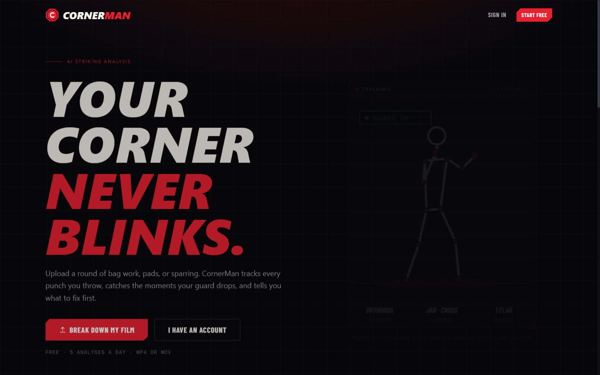
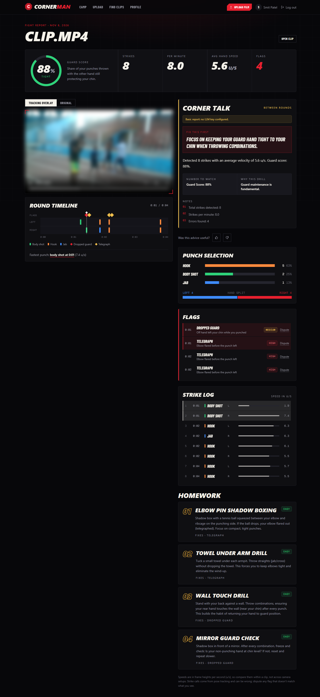
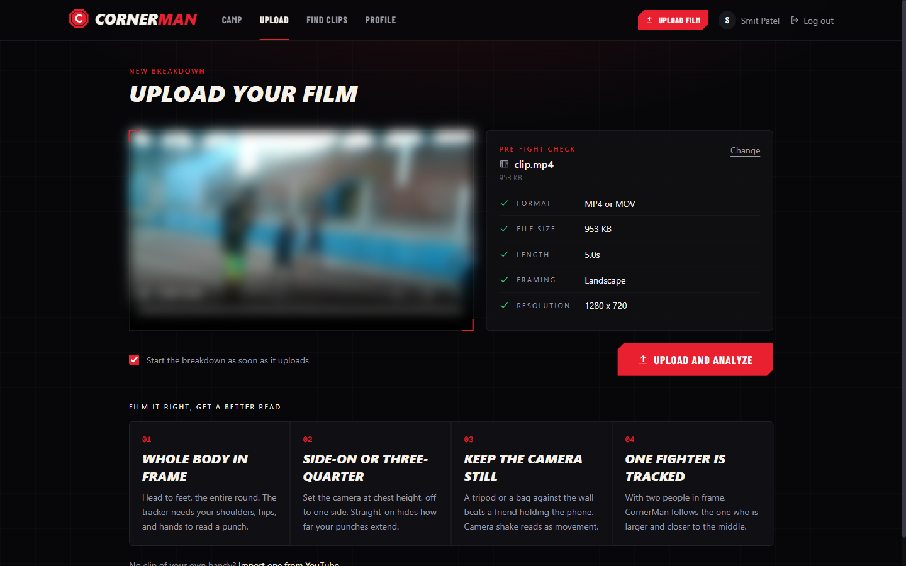
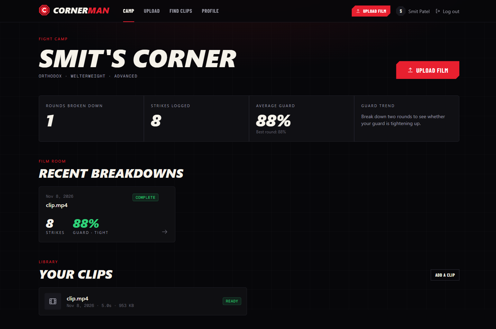
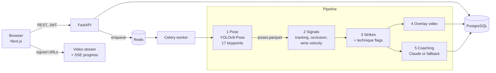

<div align="center">



# CornerMan AI

**Film a round. Get it broken down punch by punch.**

Pose tracking finds every strike in your bag work, pad rounds, or sparring, flags the
moments your guard drops or your elbow gives the punch away, and turns that into corner
advice and drills.

[](https://github.com/timsletap/CornerMan-AI/actions/workflows/ci.yml)


[What it does](#what-it-does) ·
[Measured](#measured-not-claimed) ·
[How it works](#how-it-works) ·
[Design notes](docs/DESIGN.md) ·
[Run it](#run-it) ·
[About](#about-the-builder)

</div>

---

## What it does



<sub>The fight report for the repo's test clip. Every number on it is real pipeline output
(see [Measured](#measured-not-claimed)). The corner talk shown is the built-in report used
when no LLM key is set. Footage is blurred here for privacy.</sub>

| | |
|---|---|
| **Every punch, logged** | Jabs, crosses, hooks, uppercuts, and body shots, each with the hand that threw it, its speed, and its moment in the clip. |
| **A timeline you can scrub** | One lane per hand. Click any strike or flag to jump the video to that frame, with the tracking overlay or the original footage. |
| **Guard check on every strike** | Measures the off hand against the chin on each punch and scores how often you stay covered. |
| **Telegraph detection** | Flags punches where the elbow flares before the fist moves. |
| **Corner talk and homework** | Coaching written from your numbers by Claude in a corner-coach voice, with drills mapped to the mistakes that showed up. Works without an LLM key, with a plainer report. |
| **Your call counts** | Dispute any flag you disagree with. |

<table>
<tr>
<td width="50%"></td>
<td width="50%"></td>
</tr>
<tr>
<td><sub><b>Upload.</b> The clip is checked in the browser before a byte is sent: format, size, length, framing, resolution.</sub></td>
<td><sub><b>Camp.</b> Rounds broken down, strikes logged, and how your guard is trending.</sub></td>
</tr>
</table>

## Measured, not claimed

The numbers below come from running the pipeline on the committed test clip. A script
writes them; nothing here is typed by hand, and CI fails if this block drifts from the
report.

<!-- golden:start -->
| | |
|---|---|
| Clip | `tests/golden/clip.mp4`: 4.98 s, 152 frames, 1280x720 at 30.55 fps |
| Pose model | `yolov8m-pose.pt` |
| Stage 1, pose extraction | 21.63 s (7.0 frames/s, 0.23x real time) |
| Stages 2 to 3, from cached poses | 15.0 ms median of 25 runs (332x real time) |
| Detections | 0 strikes (); flags: none; guard score 100.0% |
| Same as committed golden output | yes |
| Hardware | Intel64 Family 6 Model 198 Stepping 2, GenuineIntel, 24 logical cores, CPU only, torch 2.14.1+cpu |

Generated by `python -m tools.golden_report` at `4538ff3` from [`docs/reports/golden_run.json`](docs/reports/golden_run.json). The golden run uses lowered test thresholds so every detector fires; it measures speed and regressions, not accuracy.
<!-- golden:end -->

**What is not measured yet: accuracy.** There is no precision, recall, or F1 in this
README because there is no labeled footage to compute them against yet, and a number
without ground truth would be decoration. The tooling to produce it is built (label
schema and validator, one-to-one matching, a [labeling guide](eval/LABELING.md) with a
CVAT converter). The clips still have to be labeled.

The run above is also evidence of what needs fixing: at 3 of its 5 strike frames, both
hands "strike" in the same frame, which is body or camera motion being read as punches.
[The design notes](docs/DESIGN.md#4-what-the-first-version-gets-wrong) go through nine
such flaws and the fix planned for each.

## How it works



1. **Pose.** YOLOv8-Pose extracts 17 keypoints for every person in every frame. All of
   them are cached to Parquet, so everything after this step reruns in milliseconds.
2. **Signals.** Pick the fighter in each frame, drop occluded stretches, compute wrist
   velocity.
3. **Strikes and flags.** A strike is a debounced peak in wrist speed, classified by
   rules on the pose. Guard and telegraph checks run on each strike.
4. **Overlay.** Skeleton, strike labels, velocity vectors, and guard lines rendered onto
   the video.
5. **Coaching.** Claude writes feedback from the vision output and the fighter's profile;
   flags map to drills through a fixed table.

**[Read the design notes](docs/DESIGN.md)** for the reasoning: why stages 2 and 3 are pure
functions, how strikes are matched to labels, why the eval set is split by fighter, how
media URLs are signed, and a decision record for each major choice.

### Stack

| Layer | Tech |
|---|---|
| Frontend | Next.js 16, React 19, Tailwind CSS 4, TypeScript, Vitest |
| API | FastAPI, SQLAlchemy 2, Alembic, Pydantic v2 |
| Vision | YOLOv8-Pose (Ultralytics), OpenCV, NumPy, Parquet pose cache |
| Coaching | Anthropic Claude API, with a deterministic fallback |
| Async | Celery + Redis, progress over server-sent events |
| Data | PostgreSQL 16 |
| Video | FFmpeg, yt-dlp |
| Quality | pytest, ruff, mypy `--strict` on vision, eval, and tools; GitHub Actions |

### Built to be exposed to the internet

- Uploads stream to disk with the size limit enforced as bytes arrive, then must pass an
  ffprobe check before they are stored.
- Video and progress streams use five-minute HMAC-signed URLs, so no token ever appears in
  a URL.
- Five analyses per user per day; LLM spend is capped per user per hour from real token
  usage, and coaching falls back to the basic report at the cap.
- Deleting a clip removes its rows, the original, every overlay video, and the pose cache.
- In production the app refuses to start with a default or short secret, or with debug on.
- A parameterised test requires a 404 for a second user on every resource route.

## Run it

Requires [Docker Desktop](https://www.docker.com/products/docker-desktop/).

```bash
git clone https://github.com/timsletap/CornerMan-AI.git
cd CornerMan-AI
cp backend/.env.example backend/.env    # then set SECRET_KEY; ANTHROPIC_API_KEY is optional
docker compose up -d
docker compose exec app alembic upgrade head
```

Open **http://localhost:3000**, create an account, and upload a clip (MP4 or MOV, up to
500 MB and 30 minutes). The first build downloads the pose model.

In `backend/.env`, use the Docker host names: `db` in `DATABASE_URL` and `redis` in
`REDIS_URL`. Without `ANTHROPIC_API_KEY`, coaching uses the basic report.

<details>
<summary><b>Develop and test</b></summary>

```bash
python -m venv .venv && .venv/bin/pip install -r backend/requirements.txt -r backend/requirements-dev.txt
cd frontend && npm install && cd ..

make check            # lint, type check, and test both halves (what CI runs)
make golden-report    # re-measure the pipeline on the test clip and refresh the README table
cd frontend && npm run dev    # frontend with hot reload against http://localhost:8000
```

The frontend reads the API address from `NEXT_PUBLIC_API_URL` in `frontend/.env.local`.
Database tests need Postgres at `TEST_DATABASE_URL` and are skipped without it; video
tests need FFmpeg on the PATH.

</details>

<details>
<summary><b>Configuration</b></summary>

Key settings in `backend/.env`:

| Variable | Default | Description |
|---|---|---|
| `MAX_VIDEO_DURATION_SECONDS` | 1800 | Max video length (30 min) |
| `MAX_VIDEO_SIZE_MB` | 500 | Max upload size; larger uploads get 413 |
| `MEDIA_URL_TTL_SECONDS` | 300 | Lifetime of signed video stream URLs |
| `FREE_TIER_DAILY_UPLOADS` | 5 | Analyses per user per UTC day (free tier); the next one gets 429 |
| `API_CREDIT_HOURLY_LIMIT` | 1.00 | Max LLM spend per user per rolling hour (USD); over it, coaching uses the basic report |
| `YOLO_MODEL_NAME` | yolov8m-pose.pt | YOLO model variant |
| `VISION_FRAME_SKIP` | 1 | Analyze every Nth frame |
| `ONE_EURO_MIN_CUTOFF` | 1.0 | Keypoint smoothing cutoff (Hz) when still; lower is smoother |
| `ONE_EURO_BETA` | 0.4 | Cutoff gain per sw/s of speed; higher means less lag on fast punches |
| `ONE_EURO_D_CUTOFF` | 1.0 | Cutoff (Hz) for the speed estimate inside the filter |
| `TRACKER_CONFIG` | bytetrack.yaml | Ultralytics tracker used to keep one id per person |
| `TARGET_SELECT_SECONDS` | 2.0 | Opening window used to pick the fighter to analyze |
| `REACQUIRE_IOU` | 0.3 | Minimum box overlap to re-acquire the fighter under a new track id |
| `REACQUIRE_SECONDS` | 1.0 | How long after losing the fighter re-acquisition by overlap is allowed |
| `STRIKE_VELOCITY_THRESHOLD` | 6.0 | Wrist speed that counts as a strike, in shoulder widths per second (sw/s) |
| `GUARD_DISTANCE_THRESHOLD` | 0.6 | Off-hand wrist to nose distance that counts as a dropped guard, in sw |
| `TELEGRAPH_OFFSET_THRESHOLD` | 0.2 | Elbow swing before the punch starts that counts as a chicken wing, in sw |
| `TELEGRAPH_WINDOW_FRAMES` | 10 | Frames before the punch starts that are checked for a telegraph |
| `ONSET_FRACTION` | 0.2 | A punch starts where wrist speed reaches this share of its peak |
| `ANTHROPIC_API_KEY` | (empty) | Set for AI coaching |
| `SECRET_KEY` | (placeholder) | JWT signing key. With `APP_ENV=production` it must be at least 32 bytes and not the default, and `DEBUG` must be false |

</details>

<details>
<summary><b>API</b></summary>

| Method | Endpoint | Description |
|---|---|---|
| POST | `/api/v1/users/register` | Create account |
| POST | `/api/v1/users/login` | Get JWT token |
| GET, PATCH | `/api/v1/users/me` | Current user profile |
| POST | `/api/v1/videos/upload` | Upload video file |
| GET | `/api/v1/videos/` | List your clips |
| DELETE | `/api/v1/videos/{id}` | Delete a clip and everything derived from it |
| POST | `/api/v1/videos/{id}/analyze` | Start analysis |
| POST | `/api/v1/media/sign` | Get a short-lived signed URL for a stream |
| GET | `/api/v1/videos/{id}/stream` | Stream video (signed URL) |
| GET | `/api/v1/sessions/{id}` | Analysis results |
| GET | `/api/v1/sessions/{id}/events` | Live progress as server-sent events (signed URL) |
| GET | `/api/v1/sessions/{id}/annotated-stream` | Stream the overlay video (signed URL) |
| POST | `/api/v1/sessions/{id}/feedback` | Rate the coaching |
| POST | `/api/v1/sessions/{id}/dispute` | Dispute a flag |
| DELETE | `/api/v1/sessions/{id}` | Delete an analysis |
| POST | `/api/v1/youtube/search`, `/download` | Find and import a YouTube clip |

</details>

<details>
<summary><b>Collecting eval and training clips</b></summary>

`tools/collect` gathers footage that is legal to use and annotate: Wikimedia Commons,
Internet Archive, and (optionally) Creative Commons YouTube, plus your own recordings
with a per-fighter consent sheet. It keeps public domain, CC0, CC BY, and CC BY-SA;
NonCommercial only with `--allow-nc`; never NoDerivatives. Clips that are edited (scene
cuts), portrait, under 480p, or under 24 fps are rejected.

```bash
python -m tools.collect search --source wikimedia --query "boxing heavy bag"
python -m tools.collect fetch  --source wikimedia --query "boxing heavy bag" --limit 10
python -m tools.collect local  ~/Videos/gym --consent ~/Videos/gym/consent.yaml
python -m tools.collect credits --out eval/CREDITS.md
```

Accepted clips go to `eval/clips/` with provenance (source, license, creator, SHA-256) in
`eval/clips/manifest.jsonl`; neither is committed. Copy
`tools/collect/consent.example.yaml` for your own footage. The YouTube source needs
`YOUTUBE_API_KEY` in the environment, and YouTube's terms restrict downloading even CC
videos, so prefer the other sources. Scraping copyrighted fight footage (UFC, broadcast
clips, TikTok) is out of scope.

Label clips by following [`eval/LABELING.md`](eval/LABELING.md).

</details>

<details>
<summary><b>Troubleshooting</b></summary>

**"Failed to fetch" on login or register.** The backend isn't running. Make sure Docker
Desktop is open and `docker compose up -d` completed.

**Analysis stuck in queue.** Check the worker: `docker compose logs celery-worker --tail 20`.
Restart it with `docker compose restart celery-worker`.

**Grey or blank annotated video.** The source was likely AV1 encoded. Re-import it;
yt-dlp downloads H.264 and transcodes automatically.

**Port 3000 already in use.** Stop the local Next.js dev server or change the port in
`docker-compose.yml`.

</details>

## Where it stands

| Milestone | Status |
|---|---|
| **Cleanup.** Repo hygiene, fail-safe config, CI | Done |
| **Measure.** Golden-clip harness, pipeline split with pose cache, label schema, matching, labeling guide | Tooling done; baseline report waits on labeled clips |
| **Fix the vision.** Smoothing, body-relative units, stance-aware classification, onset telegraph, windowed guard, identity tracking | Not started, by design: each fix lands with a before and after score |
| **Trustworthy coaching.** Structured output, grounding against the vision data, low-confidence awareness | LLM cost config done; the rest not started |
| **Harden.** Streaming uploads, content validation, signed URLs, limits, SSE progress, privacy delete, isolation tests | Done, except synthetic-keypoint tests for the vision stages |
| **Go deeper.** Calibrated confidence, active-learning labeling, optimised inference, on-device shadowbox mode | Not started |

The full plan, with acceptance criteria per task, is in [`FRD.md`](FRD.md).

## About the builder

I'm **Smit Patel**. I fought for my MMA team and coached youth MMA and wrestling, and
CornerMan is the tool I wanted between sessions: something that watches the film as
closely as a coach would and tells me the one thing to fix.

That background is in the requirements more than the code. A jab is the lead hand, not a
short punch. A telegraph happens before the punch starts, not at its peak. A guard drops
during the punch, not at one frozen frame. Getting a computer to agree with those
definitions, and then proving that it does on footage it has never seen, is what this
project is about.

[GitHub: @timsletap](https://github.com/timsletap)
