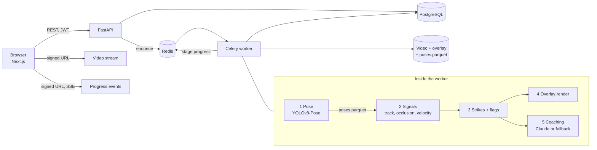

# CornerMan AI: design notes

How the system is built, why it is built that way, and what is known to be wrong with it.
Written for someone deciding whether the engineering behind the demo is sound.

**Contents**

1. [The problem](#1-the-problem)
2. [System architecture](#2-system-architecture)
3. [The vision pipeline](#3-the-vision-pipeline)
4. [What the first version gets wrong](#4-what-the-first-version-gets-wrong)
5. [Evaluation design](#5-evaluation-design)
6. [Platform decisions](#6-platform-decisions)
7. [Decision records](#7-decision-records)
8. [Status and limits](#8-status-and-limits)

---

## 1. The problem

A fighter films a round and wants to know three things: what did I throw, where was I
open, and what should I fix first. A coach answers those by watching film. CornerMan
answers them from pose: it tracks the fighter's joints through the clip, turns joint
motion into strikes and technique flags, and writes coaching from those facts.

The hard part is not drawing a skeleton. It is that **a coach who is confidently wrong is
worse than no coach**. So the project is organised around one rule: every claim the app
makes should be backed by a number measured on labeled footage, and the system should
prefer saying "unsure" to guessing. The first version did not meet that rule. Most of this
document is about closing that gap in a way that can be checked.

## 2. System architecture

**Request lifecycle for one analysis**

1. The browser uploads a clip. The API streams it to a temp file in chunks, enforcing the
   size limit as bytes arrive, then probes it with ffprobe to confirm it is a real video
   within the length limit. Rejected uploads never reach storage.
2. `POST /videos/{id}/analyze` checks the user's daily quota, creates an
   `AnalysisSession` row, and enqueues a Celery task. The API returns immediately.
3. The worker runs the pipeline. After each stage it writes `{stage, pct, message}` to
   Redis under the session id.
4. The browser opens an `EventSource` on a signed URL. The API streams progress as
   server-sent events and closes the stream on `done` or `failed`.
5. Results (strikes, flags, metrics, coaching, drill recommendations) are rows in
   Postgres. The annotated video and the pose cache are files next to the upload.

**Why this shape.** Pose inference on a 30 minute clip takes minutes, so the request path
and the compute path must be separate processes with a queue between them. Redis already
carries the queue, so it also carries the in-flight progress, which is disposable. Postgres
holds everything that must survive a restart. The database row, not Redis, decides whether
a session is finished, so a lost progress key can never strand the UI.

## 3. The vision pipeline

The pipeline is five stages with a hard boundary after the first one.

| Stage | Module | Input | Output | Cost |
|---|---|---|---|---|
| 1. Pose | `vision/pose.py` | video frames | `poses.parquet`: 17 COCO keypoints, box, and confidence for **every** detected person in every analysed frame | slow (the model) |
| 2. Signals | `vision/tracking.py`, `vision/signals.py` | poses | the tracked fighter per frame, occluded ranges, wrist velocities | milliseconds |
| 3. Strikes and flags | `vision/strikes.py`, `vision/errors.py` | signals | strike events, dropped-guard and telegraph flags | milliseconds |
| 4. Render | `vision/render.py` | frames + events | annotated H.264 video | I/O bound |
| 5. Coaching | `services/coaching.py` | vision JSON + fighter profile | structured feedback, drills | one LLM call |

Stages 2 and 3 are pure functions: no model, no database, no progress calls, no global
state. A test inspects their imports to keep it that way.

### Stage 1: pose, and why everyone is kept

YOLOv8-Pose returns 17 keypoints per person as `(x, y, confidence)` in pixels. Stage 1
writes all people to Parquet, not just the fighter, with the config that produced them in
the file metadata. Choosing who the fighter is belongs to stage 2, so a better tracker can
be tried against the same cached poses without re-running the model.

### Stage 2: from keypoints to signals

- **Who is the fighter.** Each frame scores every person by
  `0.6 * (box area / frame area) + 0.4 * (1 - distance from centre / frame diagonal)` and
  takes the best one whose mean keypoint confidence clears a threshold.
- **Occlusion.** When no person clears that threshold for longer than 0.5 s, the range is
  marked occluded and excluded from analysis, so a referee walking through frame does not
  produce strikes.
- **Wrist velocity.** For consecutive analysed frames,
  `v = sqrt(dx² + dy²) / dt / frame_height`, in frame heights per second. A sample is
  zeroed when either wrist's confidence is under 0.5.

### Stage 3: strikes and technique flags

- **Strike detection.** A strike is a local maximum of wrist speed above a threshold,
  with a 0.3 s per-hand debounce so the retraction is not counted as a second punch.
- **Classification** is a rule cascade on the pose at the strike frame: wrist below the
  upper chest is a body shot; mostly upward wrist motion is an uppercut; mostly horizontal
  motion with the elbow under 120° is a hook; otherwise jab or cross.
- **Dropped guard.** Distance from the off-hand wrist to the nose, divided by torso
  height (nose to hip midpoint), compared with a threshold. Severity scales with how far
  past the threshold it is.
- **Telegraph.** Variation of the punching elbow's x coordinate over the 10 frames before
  the strike.
- **Guard score.** The share of strikes with no dropped-guard flag.

### Stages 4 and 5

The renderer draws the skeleton, strike labels, velocity vectors, guard lines, and a HUD,
then transcodes to H.264 so every browser can play it. Coaching sends the vision JSON and
the fighter's stance, level, and weight class to Claude with a corner-coach system prompt.
With no API key, or once a user passes the hourly spend cap, a deterministic report built
from the metrics is used instead, so the product degrades to "numbers without prose"
rather than failing. Flags map to drills through a fixed table, never through the model.

## 4. What the first version gets wrong

An audit of v1 found the rules above encode several mistakes. These are not hypothetical:
the committed golden clip shows them.

Running the pipeline on [`tests/golden/clip.mp4`](../tests/golden/clip.mp4) produces 8
strikes at 5 distinct frames ([report](reports/golden_run.json)). At **3 of those 5
frames both hands "strike" in the same frame**. Two fists do not reach peak speed in the
same 33 ms by coincidence three times in five seconds. That pattern is what you get when
the whole body or the camera moves and both wrists move with it.

| # | Flaw in v1 | Why it is wrong | Planned fix |
|---|---|---|---|
| 1 | Velocity is a raw frame-to-frame difference | Keypoint jitter of a few pixels becomes a large velocity at 30 fps; jitter is high-frequency, punches are not | One Euro filter on each keypoint before differentiating |
| 2 | Wrist speed is measured in the image, not relative to the body | Stepping, bouncing, and camera shake move both wrists and read as punches (the golden-clip pattern above) | Measure the wrist relative to the shoulder midpoint |
| 3 | Speed is normalised by frame height | The same punch scores half as fast when the fighter stands twice as far away | Normalise by the fighter's own shoulder width |
| 4 | Jab versus cross is decided by arm extension | A jab is the lead hand by definition; a lazy cross and a stiff jab are misfiled | Classify by lead or rear hand from stance, auto-detecting stance from foot and shoulder order |
| 5 | Telegraph uses `std(x) / mean(x)` in pixels, ending at the velocity peak | Dividing by the mean makes the same flare score about 10x higher at the left edge of the frame than the right; and the window includes the punch itself | Use body-relative elbow motion in a window that ends at punch **onset**, not peak |
| 6 | Guard is checked at one frame | A guard that dips mid-extension and recovers by full extension is missed | Check the minimum over the whole punch window |
| 7 | The fighter is re-chosen independently every frame | In sparring the selection can jump to the partner when they step closer to centre | Persistent identity tracking with re-acquisition after occlusion |
| 8 | Strikes per minute divides by `max(1, minutes)` | A 5 s clip with 8 strikes reports 8.0 per minute instead of 96 | Divide by the real duration |
| 9 | No confidence, no abstention | Every call is presented as equally certain | Calibrated confidence and an abstain band |

None of these fixes is merged yet, deliberately. Each one changes what the system
detects, and without labeled footage there is no way to tell an improvement from a
regression that happens to look better on one clip. The order of work is therefore:
measure first (section 5), then land each fix as its own change with a before and after
score.

## 5. Evaluation design

**Labels.** One JSON file per clip: each strike with its time, hand, type, and target;
each technique error; and spans the labeler chose to skip. A Pydantic schema rejects
unknown enum values, unsorted or duplicate strikes, and times past the end of the clip,
naming the file, the index, and the bad value. The
[labeling guide](../eval/LABELING.md) fixes the judgment calls (the timestamp is the frame
of full extension; jab versus cross is lead versus rear hand, nothing else) because label
noise puts a ceiling on every metric computed from it.

**Matching.** A prediction matches a label when the hand is the same and the times are
within 150 ms. All candidate pairs are sorted by time distance and assigned greedily, one
to one. Unmatched predictions are false positives; unmatched labels are false negatives.
150 ms is about four frames at 30 fps: wide enough to absorb the gap between "peak wrist
speed" and "full extension", narrow enough that the two punches of a fast combination
cannot both match one label.

**Metrics.** Detection precision, recall, and F1; strike-type macro-F1 and a confusion
matrix computed on matched pairs only, so a classification score is not polluted by
detection misses; precision and recall per error type; a breakdown by clip tag (near or
far, camera angle, activity).

**Splits are by fighter, not by clip.** Two clips of the same person share stance, reach,
rhythm, and usually camera placement. If one is in dev and the other in test, test
performance overstates how the system does on a stranger. The validator fails if any
fighter id appears in both splits. Thresholds are tuned on dev only; test is for the final
report.

**Regression protection that exists today.** Before any labels, the golden-clip test pins
the pipeline's full output on one clip. It stayed green through the split of the
914-line monolith into stages, which is the point: on that clip the refactor changed
nothing.

## 6. Platform decisions

| Concern | What was wrong | What it does now |
|---|---|---|
| Upload memory | `await file.read()` held the whole file in RAM, with a 2 GB limit | Streams to a temp file in chunks and aborts with 413 the moment the size limit is passed; nothing is left on disk |
| Upload trust | Type checked by file extension only | ffprobe must confirm a video stream within the duration limit before the file is stored |
| Media auth | The JWT was passed as `?token=` so `<video>` could load streams, leaking it into logs, history, and referrers | Short-lived signed URLs: `HMAC-SHA256(type:id:exp)` with a key derived from the app secret by HKDF, so the media key is never the JWT key. A URL is valid for one resource for five minutes |
| Progress | The page polled an endpoint on a timer | One server-sent event stream per running session; the browser makes no polling requests and the stream closes itself on completion |
| Abuse and cost | Limits were set to 999 | Five analyses per user per UTC day (429 after that); LLM spend capped per user per rolling hour from recorded token usage, after which coaching falls back to the deterministic report while vision results still return |
| Deletion | Deleting a clip could leave derived files behind | Deleting a clip removes its rows, the original, every annotated video, and the pose cache; a test asserts nothing remains |
| Unsafe defaults | A default secret key and `DEBUG=true` would run in production | With `APP_ENV=production` the app refuses to start unless the secret is at least 32 bytes, is not the default, and debug is off |
| Isolation | Not tested | A parameterised test walks every resource route as a second user and requires 404 on all of them |

## 7. Decision records

### Heuristics before learned models

- **Context.** Strike detection could be a rule over wrist speed or a temporal model
  trained on labeled clips.
- **Choice.** Rules first. A learned model replaces a rule only when it beats it on the
  same held-out split.
- **Alternatives.** Train an action-recognition model from the start.
- **Consequence.** There is no training set yet, and a rule can be read, debugged from one
  clip, and explained to the fighter ("your elbow moved before your fist"). The cost is a
  ceiling on accuracy that the eval harness will make visible.

### Cache poses to Parquet between stage 1 and stage 2

- **Context.** Tuning any threshold used to require re-running the pose model.
- **Choice.** Stage 1 writes all detections to `poses.parquet`, keyed by the config that
  produced it; later stages read the cache.
- **Alternatives.** Keep poses in memory only; store JSON.
- **Consequence.** Measured on the golden clip: stage 1 takes tens of seconds on CPU,
  stages 2 to 3 take under 100 ms (see the README table). An eval run over a labeled set
  becomes seconds, which is what makes "score every change" practical. Parquet's typed
  list columns hold the 17-point arrays compactly. The cost is cache invalidation, handled
  by comparing stored metadata with the current config.

### Body-relative units (planned)

- **Context.** Pixel speeds depend on camera distance and resolution.
- **Choice.** Express distances in shoulder widths and speeds in shoulder widths per
  second, measured relative to the torso.
- **Alternatives.** Frame height (current); torso height; metric units from camera
  calibration.
- **Consequence.** One threshold works across distances. Shoulder width is visible from
  most angles, though it foreshortens side-on, which the by-angle eval breakdown will
  quantify. Camera calibration is not available for phone footage.

### One Euro filter for smoothing (planned)

- **Context.** Differentiating noisy keypoints amplifies the noise.
- **Choice.** One Euro filter: a low-pass whose cutoff rises with speed.
- **Alternatives.** Moving average or Savitzky-Golay (fixed lag blurs the punch peak);
  Kalman filter (needs a motion model and more parameters).
- **Consequence.** Heavy smoothing when the hand is still, which is where jitter creates
  false strikes, and little lag when it is fast, which is where timing matters. Two
  parameters to tune on dev.

### Telegraph at onset, not at peak (planned)

- **Context.** A telegraph is a tell before the punch. The current window ends at peak
  speed, so the punch itself is inside it.
- **Choice.** Find punch onset (where wrist speed first leaves its resting band) and
  score elbow flare in the window before that.
- **Alternatives.** Keep the peak-anchored window and raise the threshold.
- **Consequence.** A clean punch cannot be flagged for the motion of the punch. Onset is
  harder to localise than peak, so this depends on smoothing landing first.

### Signed URLs over cookies or query tokens

- **Context.** `<video src>` and `EventSource` cannot send an `Authorization` header.
- **Choice.** The client asks the API (with its JWT) to sign a URL for one resource; the
  URL carries an expiry and an HMAC.
- **Alternatives.** JWT in the query string (leaks a full-power credential); cookie
  sessions (adds CSRF surface and cross-site cookie configuration between two hosts).
- **Consequence.** A leaked URL exposes one video for five minutes. The client must
  re-sign on expiry, which the player and the event stream both handle.

### Server-sent events over WebSockets or polling

- **Context.** Progress flows one way, server to browser.
- **Choice.** SSE.
- **Alternatives.** Polling (wasteful, laggy); WebSockets (bidirectional machinery for a
  one-way feed).
- **Consequence.** Plain HTTP, automatic reconnect in the browser, works through ordinary
  proxies with a keepalive comment. The server side currently re-reads Redis every 0.5 s
  per open stream; Redis pub/sub would remove that if stream counts grow.

### Split the eval set by fighter

- **Context.** Clips of the same person are highly correlated.
- **Choice.** A fighter's clips all go to dev or all to test, enforced by the validator.
- **Alternatives.** Random split by clip.
- **Consequence.** Test numbers estimate performance on a new person, which is the real
  use. Fewer independent test points for the same labeling effort.

### Coaching falls back instead of failing

- **Context.** The LLM can be unavailable, unconfigured, or over budget.
- **Choice.** A deterministic report from the vision metrics, marked as such in the UI.
- **Alternatives.** Fail the analysis; queue and retry.
- **Consequence.** The fighter always gets the strike log and flags. Spend is bounded per
  user without making the product unusable at the cap.

## 8. Status and limits

Done: the stage split with the pose cache, the golden-clip harness, the label schema and
validator, one-to-one matching, the labeling guide with a CVAT converter, a licensed-clip
collector, the upload, media, limit, progress, and deletion hardening above, and CI.

Not done: a labeled eval set (so there are **no accuracy numbers yet**), every vision fix
in section 4, structured and grounded LLM output, calibrated confidence, optimised
inference, and face blurring in exports.

Known limits a user will notice: one fighter per clip; kicks, knees, and elbows are not
detected; a moving camera produces false strikes; speeds are comparable within a clip but
not across camera setups; CPU inference is far slower than real time.
